# Open Data Hub - AutoML Multimodal Support

|                |            |
| -------------- | ---------- |
| Date           | 2026-10-05 |
| Scope          | AutoML Component |
| Status         | Proposed |
| Authors        | Lukasz Cmielowski |
| Supersedes     | N/A |
| Superseded by: | N/A |
| Tickets        | [RHAISTRAT-3067](https://redhat.atlassian.net/browse/RHAISTRAT-3067) |
| Other docs:    | [ODH-ADR-0001](./ODH-ADR-0001-automl.md) · [ODH-ADR-0002](./ODH-ADR-0002-experiment-settings.md) · [ODH-ADR-0003](./ODH-ADR-0003-model-insights.md) · [ODH-ADR-0004](./ODH-ADR-0004-mlflow-integration.md) |

## What

Extend OpenShift AI AutoML with a generic **AutoGluon MultiModal (AutoMM) training path**, initially supporting image prediction.

The first supported workload is supervised image classification and regression, with an optional mix of image, numeric, categorical, and text feature columns. It uses AutoGluon's `MultiModalPredictor`, which fine-tunes a pretrained vision model and, for mixed data, fuses the representations from the available modalities.

This decision changes the non-goal for non-tabular data in [ODH-ADR-0001](./ODH-ADR-0001-automl.md): images are in scope only through the new, bounded AutoMM pipeline contract defined here. The existing tabular and time-series contracts remain unchanged.

## Why

Image datasets are common in quality inspection, retail, geospatial analysis, life sciences, and document-adjacent workflows. Users need a supported route from an S3-hosted image dataset to a registered and deployable predictor without writing a custom PyTorch training workflow.

AutoMM is appropriate because it accepts image-only data as well as image, text, and tabular columns in a DataFrame, and exposes a common predictor API for fit, evaluation, prediction, probability prediction, and embeddings. It is not interchangeable with `TabularPredictor`: it is a deep-learning workload with PyTorch/CUDA dependencies, pretrained-model acquisition, materially larger artifacts, GPU scheduling needs, and an image/bytes inference request.

## Decision

Provide a **new, independently versioned `autogluon_multimodal_training_pipeline`**. It has its own public pipeline contract, KFP components, GPU resource profile, artifacts, and serving integration. It is a branching pipeline: a common multimodal lifecycle selects a task-family branch, and each branch owns its validation, training configuration, metrics, artifacts, and inference schema.

The initial public product contract is the `image_prediction` branch:

| Area | Initial support |
| --- | --- |
| Predictor | `autogluon.multimodal.MultiModalPredictor`, version pinned by the training and serving images |
| Learning tasks | Binary classification, multiclass classification, and regression |
| Modalities | One image column; optional text, numeric, categorical, and boolean feature columns in the manifest |
| Image inputs | PNG, JPEG, WebP, and other Pillow-supported raster formats that pass validation; one primary image per row for the initial UX |
| Training data | A CSV or Parquet manifest plus image objects in S3-compatible storage |
| Compute | GPU required for the supported production profile; CPU execution may be used only for development and compatibility testing |
| Output | One saved `MultiModalPredictor` per completed backbone in the curated sweep, a run-level leaderboard, evaluation/diagnostic artifacts, and notebooks |
| Serving | Extend the existing KServe AutoGluon ServingRuntime to load `MultiModalPredictor` and handle image-aware v1/v2 requests |

The pipeline owns the curated backbone sweep and leaderboard. Each leaderboard row represents an independently trained, saved predictor that the user can register and deploy.

## Goals

* Provide a supported Dashboard and API workflow from dataset to deployable predictor.
* Support secure data access and reproducible training and inference.
* Reuse existing platform integrations and establish measurable acceptance gates.

## Non-Goals

* Replacing the tabular or time-series pipelines, or combining their parameters into one polymorphic pipeline.
* Object detection, instance/semantic segmentation, image/text similarity, zero-shot classification, feature extraction, OCR/PDF, video, audio, NER, or generative image tasks in the first release.
* Arbitrary directory layouts, archives, HTTP URLs, or data embedded directly in pipeline parameters.
* A general-purpose experiment/HPO platform for every AutoMM model or model zoo.
* Multi-GPU or distributed training in the initial release.
* Automatically registering or deploying a model as a training-pipeline step.
* Guaranteeing that a predictor trained on one AutoGluon/PyTorch/CUDA combination loads in an unpinned, arbitrary runtime.

## How

### Data contract and ingestion

The pipeline accepts a **manifest**, not an image archive. The manifest is CSV or Parquet and has one row per training example, with one image per row. It must include a label column and exactly one declared image column. Image column values are object paths relative to the manifest's directory in its S3 bucket, never arbitrary local paths or URLs. For example, `images/0001.jpg` in `datasets/products/train.csv` resolves to `datasets/products/images/0001.jpg`. The pipeline retrieves the manifest and image objects through the supplied namespace-scoped RHOAI Connection.

Example manifest:

```csv
image_key,product_title,weight_grams,category
images/0001.jpg,Blue running shoe,310,shoe
images/0002.jpg,Canvas tote bag,460,bag
```

Validate the manifest and image references for safe access and suitability for training. Report data-quality failures before training; unreadable training images fail the run.

### Public pipeline parameters

Names are proposed here and become stable only when implemented in `pipelines-components` and reviewed with Dashboard/API consumers.

| Parameter | Type | Required | Description |
| --- | --- | --- | --- |
| `train_data_secret_name` | `str` | Yes | S3-compatible Connection Secret, using the existing AutoML credential-key convention. |
| `train_data_bucket_name` | `str` | Yes | Bucket containing the manifest and image objects. |
| `train_data_file_key` | `str` | Yes | Object key of the CSV or Parquet manifest. |
| `task_family` | `str` | Yes | Selects the multimodal branch. Initial and only supported value is `image_prediction`; future values require their own validated contract. |
| `label_column` | `str` | Yes | Target column. It is not a scoring input. |
| `image_columns` | `List[str]` | Yes | Manifest column containing image paths relative to that manifest's directory. The pipeline requires exactly one. |
| `feature_columns` | `Optional[List[str]]` | No | Training-feature allowlist for excluding ID/metadata columns. Must include the image column and exclude the label. When omitted, all non-label manifest columns are features. |
| `task_type` | `str` | Yes | `binary`, `multiclass`, or `regression`. |
| `test_data_bucket_name` / `test_data_file_key` | `Optional[str]` | No | Paired external test manifest for final reporting only, using the same connection and schema. |
| `preset` | `str` | No | Product-level GPU quality tier; see below. |
| `eval_metric` | `Optional[str]` | No | AutoMM metric valid for `task_type`; default resolves to AutoMM's problem-type default. |
| `time_limit_seconds` | `int` | No | Per-backbone AutoMM `fit` time budget, excluding download, staging, and upload. Sequential sweep wall-clock time scales with the number of backbones. |

Only the manifest reference goes through pipeline parameters. Credentials remain in the Secret, and image bytes never appear in KFP parameters, KFP metadata, MLflow parameters, logs, or notebook output.

### Pipeline shape

```mermaid
flowchart LR
    A[S3 manifest + image objects] --> B[Validate manifest and images]
    B --> C[Stage data]
    C --> D[Create fixed training, tuning, and selection splits]
    D --> E[Curated backbone sweep]
    E --> F[GPU: MultiModalPredictor.fit per backbone]
    F --> G[evaluate each saved predictor]
    G --> H[Run-level leaderboard]
    H --> T[Optional external test reporting]
    T --> I[Per-backbone predictor artifacts]
    I -. post-pipeline .-> J[Model Registry]
    J --> K[KServe AutoGluon ServingRuntime with multimodal support]
```



Staged images and dataset splits remain available to downstream training and evaluation components through KFP-managed artifacts or shared run-scoped storage.

Runtime resources follow platform HardwareProfiles. Resource sizing, scheduling settings, transfer behavior, storage configuration, and timeouts are defined in pipeline documentation and validated by benchmarks.

### Backbone sweep and leaderboard

The pipeline owns a **curated sweep**:

1. Stage and split the dataset once using an internal split policy, stratified for classification when possible. All backbones use identical training, tuning, and selection splits. Optional external test data is reserved for final reporting and does not influence fitting or backbone ranking.
2. Resolve the curated backbone list from `preset`. The list is a small, license-reviewed TIMM set shipped with the training image.
3. Train each backbone with the same label, task, metric, seed, and per-fit `time_limit_seconds`, save the predictor, and evaluate it on the selection split, which is excluded from fitting and tuning.
4. Write a run-level leaderboard ranked by `eval_metric`. Record the ranking metric, its optimization direction, and any score transformation. Each row names the backbone id, selection scores, fit duration, and the path to that predictor directory; final test scores are reported separately.
5. Package every completed predictor as a registerable artifact. The user selects a leaderboard row to register.

Fits run **sequentially on one GPU** in the initial release. A failed backbone must not discard siblings that already completed; the leaderboard records the failure and ranks the successful predictors.

### Quality tiers, resources, and provenance

`speed` and `balanced` are product labels with their own multimodal model policies. Resource and training-budget defaults are maintained in pipeline documentation and established through benchmarking.

| Tier | Intent | Model policy |
| --- | --- | --- |
| `speed` | Fast feedback | One curated TIMM backbone |
| `balanced` | Compare a short curated set | Multiple license-reviewed TIMM backbones trained sequentially |

Before GA, supported limits and defaults must be backed by benchmarks on representative datasets. Artifacts and MLflow must record sufficient data, model, configuration, and runtime provenance to reproduce a run. Detailed benchmark measures and metadata fields belong in pipeline documentation and the shared artifact contract.

All model dependencies must be packaged or available through an approved cache for offline/restricted-egress operation, including text checkpoints and tokenizers when text features are enabled. Supply-chain approval is covered under Security and Privacy Considerations.

### Artifacts, evaluation, and MLflow

Each completed backbone has an artifact directory named by its curated backbone id. This directory is the Model Registry / KServe storage URI and includes the saved predictor and metadata required by its serving adapter.

| Path | Content |
| --- | --- |
| `{backbone_id}/predictor/` | Saved `MultiModalPredictor` for that backbone, including required local model/tokenizer/config files. |
| `{backbone_id}/model.json` | Predictor type/version, backbone id and checkpoint/checksum, task, class mapping, feature schema, input normalization, artifact compatibility, and serving schema. |
| `{backbone_id}/metrics/metrics.json` | Selected evaluation metric and supported task metrics from `predictor.evaluate`. |
| `{backbone_id}/metrics/confusion_matrix.json` | Classification only, with class order recorded. |
| `{backbone_id}/metrics/per_class.json` | Classification precision, recall, F1, support, and optionally calibrated confidence summaries. |
| `{backbone_id}/metrics/training_summary.json` | Fit duration, hardware profile, best checkpoint summary, model size, and peak resource telemetry where available. |
| `{backbone_id}/notebooks/automl_multimodal_predictor_notebook.ipynb` | Reproducible load/evaluate/predict example using non-sensitive placeholder inputs. |
| `metrics/leaderboard.json` | Run-level ranking of completed backbones by `eval_metric`, with paths to each `{backbone_id}/` directory. Failed backbones are listed with error class, not a fake score. |
| `metrics/data_quality.json` | Manifest/image validation summary, dimensions/formats, split sizes, class distribution, and dropped-row count. Shared by the run; no image content or sensitive paths. |

`model.json` extends the shared contract in [ODH-ADR-0003](./ODH-ADR-0003-model-insights.md) but requires a new `predictor_type: "autogluon.multimodal.MultiModalPredictor"` and `inference.image_inputs` section. Dashboard uses the predictor type to select the serving schema and reuses the leaderboard selection flow for registration.

The existing [MLflow integration](./ODH-ADR-0004-mlflow-integration.md) remains the parent-run mechanism. Log one nested child run **per completed backbone**, plus parent aggregate status (`num_models_trained` is the number of completed sweep members). Log non-secret configuration, backbone id, data checksum/approved URI, runtime provenance, and evaluation metrics. Log artifact references rather than duplicate large predictor files unless an MLflow artifact-retention policy explicitly authorizes duplication.

### Serving and request contract

Extend the existing KServe AutoGluon ServingRuntime to load `MultiModalPredictor` artifacts and support image-aware v1/v2 requests, while preserving existing tabular and time-series serving behavior. The runtime must verify predictor readiness before accepting traffic.

For the initial remote API, clients submit image **bytes encoded as base64**, using an `image.b64` field in v1 or base64 strings in a `BYTES` input tensor for v2 REST, together with scalar companion features. They do not send local paths, S3 URIs, Connection names, or credentials. Serving validates requests against size, media-type, pixel-count, batch-size, and timeout limits, and returns predictions and, when enabled, probabilities. A representative v1 request is:

```json
{
  "instances": [
    {
      "image": {"b64": "..."},
      "product_title": "Blue running shoe",
      "weight_grams": 310
    }
  ]
}
```

`model.json` maps public request fields to training columns (for example, `image` to `image_key`) and defines their types, batch shapes, and image encoding. The generated model schema also specifies required fields, maximum decoded bytes/pixels, model input image size, allowed batch size, output labels/class order, and whether probability output is enabled. KServe v2 tensor names and shapes are generated from this schema. Request bodies, decoded images, and inference paths must not be logged; decoded data is retained only for the request lifetime.

Multimodal predictors may be served on CPU or GPU, independently of the device used for training. Supported serving profiles are validated for compatibility, memory usage, and latency. Model Registry registration and KServe deployment continue to be user/platform actions after training.

### Acceptance gates

Required gates:

* Reproducible train → register → deploy → infer tests on the supported OpenShift AI release and GPU profile.
* Offline/restricted-egress validation covers all supported feature types.
* Dataset and serving contract negative tests cover corrupt/oversized images, traversal, missing objects, malformed base64, unsupported media, and secret leakage.
* Packaged predictors pass training/serving compatibility, readiness, and rollback tests on the pinned stack.
* Benchmark evidence supports the declared resource tiers, quotas, timeout defaults, and cost/user guidance.
* Model-quality report includes holdout metrics, class imbalance behavior, data leakage checks, and per-class results for classification.
* Security, privacy, and licensing reviews are approved.

## Alternatives

### 1. Put image paths into the existing tabular pipeline

**Rejected.** `TabularPredictor` can have image-related capabilities, but it does not establish the AutoMM GPU, artifact, or byte-serving lifecycle required here. It would overload tabular parameters and misrepresent deep-learning training as a tabular ensemble/refit workflow.

### 2. Add a generic “multimodal” pipeline for every AutoMM task now

**Rejected.** AutoMM spans classification, regression, detection, segmentation, similarity, NER, and more. Their datasets, annotations, metrics, dependencies, resource profiles, artifacts, and serving responses differ substantially. Image classification/regression is the narrowest path that validates the platform seams; other tasks require separate ADRs or explicit extensions.

### 3. Support object detection first

**Rejected for the first release.** Detection requires different annotations, evaluation, and serving contracts.

### 4. Require users to train custom notebooks and deploy custom runtimes

**Rejected as the supported AutoML path.** It leaves reproducibility, GPU configuration, model provenance, security controls, and Dashboard integration to every user. It remains a valid advanced-user escape hatch.

### 5. Serve by S3 URI or presigned URL

**Rejected.** It would expose storage topology/credentials, complicate tenant boundaries and request auditing, make prediction availability depend on object-store access, and create SSRF-like URL handling risks. Base64 bytes are more portable and keep the model-serving request self-contained.

## Security and Privacy Considerations

* RHOAI Connections remain namespace-scoped and are used only by training/staging components. Serving never uses training data credentials.
* Treat images, EXIF metadata, filenames, and labels as potentially sensitive. Strip/ignore EXIF where feasible, do not emit samples into logs, MLflow parameters, notebooks, or error messages, and use existing artifact-store access controls.
* Defend ingestion and serving against decompression bombs, malformed image decoders, oversized pixel counts, path traversal, and resource exhaustion with explicit size/dimension/count limits and bounded workers.
* Scan and sign training/serving images; maintain SBOMs and remediation policy for PyTorch, Pillow, Transformers, TIMM, and any optional model-zoo dependency. Pin weights and code revisions with checksums.
* Review dataset consent, biometric/medical/sensitive-image policy, label bias, representational harm, and the licensing/acceptable-use terms of pretrained weights before enabling a model family.
* Apply KServe authentication, authorization, network policy, quotas, and request limits. Image payloads must be redacted from observability data.

## Risks

| Risk | Mitigation |
| --- | --- |
| GPU scarcity, cost, or long queue times | Explicit HardwareProfile, quota guidance, tier-specific limits, sequential sweep on one GPU, visible pending status, and feature gating. Document that `balanced` wall-clock time scales with the number of backbones. |
| GPU out-of-memory or local disk exhaustion | Curated backbones, bounded image resolution/batch size, validated resources, PVC sizing, and benchmark gates. |
| Training/serving incompatibility | Compatibility and readiness acceptance gates on the supported pinned stack. |
| Pretrained-weight download or license failure | Offline availability and supply-chain approval gates. |
| Large image payloads degrade serving | Request limits and platform resource controls. |
| Weak or biased results on sparse/imbalanced data | Minimum-data guidance, stratified splitting where applicable, per-class reporting, and user-visible data-quality warnings. |
| AutoMM upstream API/dependency churn | Pin supported release, maintain an integration test matrix, and upgrade deliberately rather than resolving dependencies at run time. |

## Stakeholder Impacts

| Group | Impact |
| --- | --- |
| AutoML / pipelines-components | New GPU pipeline, data staging, sequential backbone sweep, leaderboard artifacts, tests, and release maintenance. |
| RHOAI Dashboard and API | New dataset form, validation, run presentation, predictor-type branching, backbone leaderboard, and image scoring UX. |
| Data Science Pipelines / platform operators | GPU scheduling, HardwareProfiles, quotas, storage, image lifecycle, and supportability. |
| Model Registry and serving | AutoMM model metadata and multimodal support in the existing KServe AutoGluon ServingRuntime. |
| MLflow integration | One child run per completed backbone and larger artifact/provenance handling. |
| Security, legal, and product | Data/weight licensing, supply-chain review, privacy policy, and support-tier decision. |

## References

* [AutoGluon MultiModal documentation](https://auto.gluon.ai/stable/tutorials/multimodal/index.html)
* [AutoMM image classification quick start](https://auto.gluon.ai/stable/tutorials/multimodal/image_prediction/beginner_image_cls.html)
* [AutoMM image + text + tabular quick start](https://auto.gluon.ai/stable/tutorials/multimodal/multimodal_prediction/beginner_multimodal.html)
* [AutoGluon `MultiModalPredictor` API](https://auto.gluon.ai/stable/api/autogluon.multimodal.MultiModalPredictor.html)
* [AutoGluon installation and GPU guidance](https://auto.gluon.ai/stable/install.html)
* [KServe image inference examples (v1/v2)](https://github.com/kserve/kserve/blob/master/python/custom_model/model.py)
* [AutoML architecture](./ODH-ADR-0001-automl.md)
* [AutoML model insights](./ODH-ADR-0003-model-insights.md)
* [AutoML MLflow integration](./ODH-ADR-0004-mlflow-integration.md)

## Reviews

| Reviewed by | Date | Approval | Notes |
| --- | --- | --- | --- |
|  |  |  |  |
