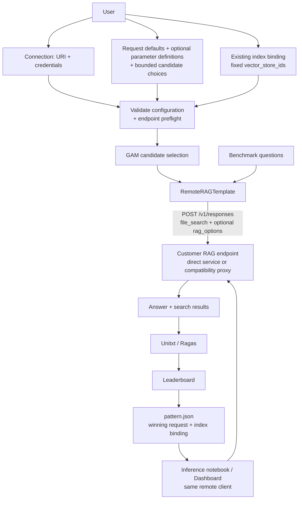

# Open Data Hub - AutoRAG Custom RAG Template

|                |            |
| -------------- | ---------- |
| Date           | 2026-10-12 |
| Scope          | AutoRAG Component |
| Status         | Proposed |
| Authors        | Lukasz Cmielowski |
| Supersedes     | N/A |
| Superseded by: | N/A |
| Tickets        | |
| Other docs:    | [ODH-ADR-0001](./ODH-ADR-0001-autorag.md) · [ODH-ADR-0003](./ODH-ADR-0003-rag-templates.md) · [ODH-ADR-0004](./ODH-ADR-0004-rag-pattern-inference.md) · [ODH-ADR-0005](./ODH-ADR-0005-rag-pattern-evaluation.md) · [ODH-ADR-0006](./ODH-ADR-0006-mlflow-integration.md) |

## What

Allow AutoRAG users to optimize existing customer-hosted RAG applications through a defined subset of the **Responses API and `file_search` contract**. AutoRAG treats the application as a black box: the endpoint owns retrieval and generation over an already-built index; AutoRAG owns experiment orchestration, evaluation, ranking, artifacts, and MLflow integration.

The endpoint may be implemented directly by the customer's RAG service or by a customer-managed compatibility proxy. A proxy may translate requests and responses between this contract and the service's native API; the underlying service need not change its API.

AutoRAG varies supported Responses and `file_search` request parameters and, optionally, schema-defined proprietary controls under a `rag_options` request extension. Responses and search results retain the standard envelope. Customer-managed compatibility proxies handle any translation to the application's native API.

ai4rag provides a `RemoteRAGTemplate` (`BaseRAGTemplate` subclass) for this contract. The customer makes the index available to the endpoint before the experiment; its binding remains fixed throughout optimization.

## Why

Customers often already run proprietary retrieval, reranking, agents, or generation behind an HTTP API. A standard external contract lets AutoRAG optimize these services without importing customer code or knowing their implementation.

A bounded Responses + `file_search` contract:

* Reuses the inference wire format in [ODH-ADR-0004](./ODH-ADR-0004-rag-pattern-inference.md).
* Provides a known parameter vocabulary and result structure for AutoRAG and the Dashboard.
* Fits RHOAI Connections (`uri` + credentials).
* Supplies retrieved passages and document identity for Unitxt / Ragas evaluation.
* Keeps customer dependencies and tool execution outside the AutoRAG image.

The endpoint may use custom functions or agent flows internally. It must expose the agreed request controls and file-search results externally. Compatibility describes the HTTP contract; it does not require using OpenAI-hosted storage or models.

## Goals

* Optimize remote retrieve-and-generate services through one Responses + `file_search` contract.
* Use `RemoteRAGTemplate` and a Connection parameter (`custom_rag_secret_name`).
* Optimize against an existing index managed by the customer application.
* Explore a bounded search space over standard request fields and declared proprietary request-time controls.
* Preserve evaluator-qualified metrics, leaderboards, `pattern.json`, and MLflow parent/child runs.
* Reuse the winning request configuration for inference, keeping credentials as Connection references.

## Non-Goals (v1)

* Full Responses API coverage, streaming, or server-side conversation management.
* Arbitrary JSON Schemas, executable parameter definitions, or custom response envelopes in AutoRAG.
* Endpoint-specific request mappings or arbitrary REST adapters configured or executed by AutoRAG. Customer-managed compatibility proxies are allowed.
* Returning unfinished function calls for AutoRAG to execute and resume.
* Optimizing chunking, embedding models, or settings requiring index construction or modification.
* Building, refreshing, or promoting indexes, including invocation of the built-in indexing pipeline for custom RAG applications.
* Custom ingestion APIs on the endpoint, including Files / Vector Stores upload APIs.
* OCI custom template workers, customer Python hooks, or Papermill execution inside optimization.
* Guaranteeing endpoint availability or answer quality, or supporting customer implementation internals.

## How

### Ownership boundary

| Responsibility | Owner |
| --- | --- |
| Retrieval, generation, internal agents and tool execution | Customer endpoint |
| Compatibility proxy, request/response translation, and authentication to downstream services when a proxy is used | Customer |
| GAM, benchmark handling, Unitxt / Ragas, leaderboard, and artifacts | AutoRAG |
| Index preparation, maintenance, and mapping to `file_search.vector_store_ids` | Customer |
| Connection authorization and network reachability | User / platform |

When a proxy is used, the Connection points to the proxy. The customer owns preservation of the selected controls' semantics, actual retrieval results, document identities, and errors across translation. Unsupported controls are rejected clearly; retrieved passages and document identities reflect the underlying service. Proprietary controls use the declared extension contract below.

### Configuration and search space

#### Inputs

| Parameter | Role |
| --- | --- |
| `custom_rag_secret_name` | Connection to the endpoint (`uri`, API key / token). |
| `custom_rag_config` | Non-secret fixed request settings, optional proprietary parameter definitions, and document-id mapping. |
| `search_space_config` | Finite candidates for standard request fields and proprietary controls, expressed as independent dimensions or complete parameter sets. |

The user supplies index ids already queryable by the endpoint. Corpus and database Connections are managed by the customer application. Benchmark, objective, budget, and evaluator settings follow the normal AutoRAG pipeline.

#### Fixed settings and candidate selection

`custom_rag_config.request` supplies fixed request settings. This ADR extends the [ADR 0002 search-space contract](./ODH-ADR-0002-experiment-settings.md#search-space-configuration) with `remote_request` for standard request candidates and either `remote_parameters` or `remote_parameter_sets` for proprietary candidates. Remote runs use these sections rather than built-in chunking, retrieval, or generation dimensions.

Candidate lists are finite and non-empty; one value fixes a setting. Candidate selections replace only the corresponding request fields, preserving other fixed settings. Omitted fields retain their fixed value or the endpoint's documented default.

When `remote_request.tools` is present, it contains exactly one entry with `type: "file_search"`. The discriminator is required and fixed, not a candidate dimension. Candidate values replace matching fields in the fixed request's single tool; they do not replace the tool array or its index binding. Missing or different discriminators and multiple tool entries are configuration errors.

A complete [configuration example](#configuration-example) is included in the appendix.

Endpoint URLs and credentials come from the Connection, outside these non-secret settings.

#### Standard request fields

The v1 compatibility profile is named `responses.file_search.v1`. It defines the following allowlist from the [Responses API reference](https://developers.openai.com/api/reference/python/resources/responses/methods/create):

| Request field | v1 treatment |
| --- | --- |
| `tools[0].max_num_results` | Required retrieval control; fixed value or finite candidate choices. Limits returned search results, not index construction. |
| `tools[0].ranking_options.score_threshold` | Optional candidate choices, within the documented range of 0–1. |
| `tools[0].ranking_options.ranker` | Optional choices among documented ranker identifiers supported by the endpoint. Proprietary strategies use `rag_options`. |
| `model` | Fixed model id or finite candidate choices supported by the endpoint. |
| `temperature` or `top_p` | Optional candidate choices where the selected model supports them; vary at most one per experiment. |
| `max_output_tokens` | Fixed output-token budget or finite candidate choices. |
| `instructions` | Fixed instructions or an explicit set of candidate instruction strings. |

The following fields are fixed controls, not optimization dimensions:

* `tools` contains exactly one tool, with `type: "file_search"`.
* `tools[0].vector_store_ids` binds the prepared index and remains unchanged across candidates.
* Optional `tools[0].filters` expresses the experiment's corpus / access constraints and remains unchanged across candidates. Endpoint authorization remains mandatory.
* AutoRAG supplies `input`, `stream: false`, `store: false`, `tool_choice: {"type": "file_search"}`, and `include: ["file_search_call.results"]`.
* Each benchmark question is evaluated independently; conversation ids and previous-response state are not used.

Additional standard Responses fields require an explicit profile revision. Proprietary parameters are accepted only through the optional `rag_options` extension described below.

When `instructions` is absent from both the fixed request and search space, AutoRAG omits it and the endpoint retains its default instructions. When supplied, the endpoint honors its Responses API semantics or rejects the control as unsupported.

#### Proprietary controls

The endpoint owner defines request-time controls in `custom_rag_config.parameter_schema`. Each named parameter has a scalar type (`string`, `integer`, `number`, or `boolean`), optional allowed values (`enum`), and numeric bounds where applicable. This is a bounded schema vocabulary; arbitrary schemas, code, and request-mapping expressions are outside the contract. Parameter names identify direct members of `rag_options`, not paths into other request fields.

Each trial sends selected proprietary values in the top-level `rag_options` request object. See the [proprietary configuration example](#proprietary-configuration-example). Fixed proprietary values may be supplied in `custom_rag_config.request.rag_options`; candidate values override them. All supplied values must match the declared schema.

`rag_options` is an AutoRAG extension, not a standard Responses API field. The customer endpoint or proxy explicitly supports it and owns parameter semantics. Definitions are validation metadata, not request fields; they cannot override authentication, index bindings, access constraints, or standard fields. Endpoints using only the standard profile omit `rag_options`.

#### Dependent controls

`remote_parameters` describes independent dimensions whose values may be combined freely. For dependent controls, `remote_parameter_sets` supplies a finite, non-empty list of complete, valid `rag_options` objects instead. For example, disabling reranking omits `reranking_top_k`:

```yaml
search_space_config:
  apiVersion: autorag.opendatahub.io/v1alpha1
  kind: AutoRAGSearchSpace
  remote_parameter_sets:
    - reranking_strategy: none
    - reranking_strategy: cross_encoder
      reranking_top_k: 10
    - reranking_strategy: cross_encoder
      reranking_top_k: 20
```

`remote_parameters` and `remote_parameter_sets` are mutually exclusive. Each parameter set is one indivisible candidate: its values are not recombined with other sets. The selected object replaces the entire request `rag_options`, including any fixed defaults, so omitted members remain absent. Standard `remote_request` dimensions can still vary alongside the chosen set.

The endpoint owner supplies valid combinations. Complete sets express dependencies without conditional schema rules.

#### Validation and persistence

AutoRAG validates the standard profile, declared parameter types and bounds, and known standard-field combinations. The endpoint validates proprietary combinations and honors the selected controls without changing the index. Unsupported names, values, or combinations produce clear errors. Run artifacts retain the effective search space, parameter definitions, and complete parameter sets; the winning request preserves selected values for inference.

### ai4rag: `RemoteRAGTemplate`

```text
BaseRAGTemplate
  └── RemoteRAGTemplate   # Responses + file_search HTTP client
```

Responsibilities:

* `parameter_schema()` combines the built-in profile with declared proprietary parameters, preserving complete parameter sets as indivisible candidate choices.
* `run(question, settings, …)` sends the request, including `rag_options` when configured, validates the response, and returns normalized `answer`, `answer_contexts[]`, and status/error for AutoRAG evaluators.
* Index construction and internal tool execution remain outside this client.

Patterns use `template_id: "custom:remote_responses"`.

### Wire contract

AutoRAG calls `POST {uri}/v1/responses` using the endpoint URL and authentication from the Connection. Complete [request and response examples](#request-and-response-examples) are included in the appendix.

A successful response has `object: "response"`, `status: "completed"`, completed `file_search_call` output with included results, and a final assistant message containing `output_text`. The endpoint completes retrieval and generation within this call; AutoRAG does not execute function calls returned by the service.

Prefer canonical benchmark document keys directly in each returned `file_id`; a customer-managed proxy can translate endpoint-local ids. `document_keys` supports small explicit mappings from endpoint-local ids to canonical keys, not a full-corpus catalog. It is evaluation metadata and is not sent to the endpoint.

The client concatenates the final assistant message's text blocks to produce `answer`. Included search-result text becomes `answer_contexts[]`. Every result requires a non-empty `file_id` that resolves to a canonical `document_key` in the benchmark's `correct_answer_document_keys` namespace ([ODH-ADR-0002](./ODH-ADR-0002-experiment-settings.md#benchmark-json)). Keys identify full source object paths, not basenames or chunk ids. Filename or attribute fields do not substitute for `file_id`. File citations alone cannot replace retrieved text or document identity ([OpenAI file-search contract](https://developers.openai.com/api/docs/guides/tools-file-search)).

For multiple `file_search_call` items, `answer_contexts[]` concatenates results in `output[]` order and then each call's result order, preserving duplicate passages and their document identities. Evaluation artifacts retain search-call boundaries, queries, scores, and result order, and record `context_source: "retrieval_results"`: results do not prove exactly which passages generation consumed. This concatenation is not a global ranking; rank-based metrics are unavailable unless the evaluator supports the step structure.

A completed search call with `results: []` is a valid no-results outcome. Missing search calls, missing or invalid result data, ambiguous answers, and unsuccessful responses are failures. Failed benchmark responses remain visible; candidates with incomplete evaluation are excluded from normal ranking. AutoRAG computes evaluator scores locally and never treats endpoint-provided scores as Unitxt / Ragas metrics.

After local validation of the entire search configuration, endpoint preflight uses one representative benchmark question and a concrete configuration drawn from the candidate space. It requires HTTP 200, a completed answer, included search results, and resolvable document identities. Preflight checks conformance for that configuration; it does not establish support for every candidate combination. A health or models endpoint alone does not establish conformance. The endpoint returns standard Responses usage and error information where applicable; unavailable usage is not recorded as zero.

### Execution and failures

Request timeouts, concurrency, and retry budgets are AutoRAG execution settings, separate from searchable endpoint parameters. Their defaults are documented with the pipeline.

* Transient transport, rate-limit, and service failures are retryable within the execution budget; exhausted retries leave the evaluation incomplete.
* Candidate-specific parameter validation errors are not retried. The candidate fails and remains visible, without normal ranking.
* Authentication, authorization, and shared response-contract failures stop the run with a diagnostic rather than consuming further candidate budget.

### Existing index

The endpoint has a queryable index before optimization starts. `file_search.vector_store_ids` identifies that index and remains fixed across candidates and in the winning request configuration. The customer application owns index construction, updates, and compatibility with its retrieval implementation. Promotion reuses the existing endpoint and index binding.

### End-to-end flow



### User experience

1. Deploy or select a conforming RAG service, or place a customer-managed compatibility proxy in front of an existing service. Create a Connection to the conforming endpoint.
2. Supply the ids of an existing index queryable by the service.
3. In the AutoRAG wizard, choose **Custom (Responses + file_search)**, select the Connection, and configure fixed values and candidate choices for standard fields and any declared proprietary parameters. Supply document-id mapping if needed.
4. Choose the benchmark, objective, and budget. Validate the configuration and endpoint before starting GAM.
5. Inspect the leaderboard and retrieved contexts, then promote the winning request configuration for remote inference.

The wizard uses AutoRAG's standard field definitions and the endpoint owner's declared parameter types and constraints.

### Artifacts and MLflow

Custom patterns extend [ODH-ADR-0004](./ODH-ADR-0004-rag-pattern-inference.md) with a remote inference variant. Evaluation and MLflow retain [ODH-ADR-0005](./ODH-ADR-0005-rag-pattern-evaluation.md) / [ODH-ADR-0006](./ODH-ADR-0006-mlflow-integration.md).

* `template_id: "custom:remote_responses"` and `inference.kind: "remote_responses"` select remote invocation. No built-in deployment `runtime_spec` is generated.
* `settings.request` records the complete effective non-secret winning request, excluding the per-question `input`. Its `vector_store_ids` are the authoritative remote index binding.
* `inference.remote_spec` records the compatibility profile, Connection reference, and document-id mapping. There is no endpoint-specific manifest or proprietary response profile.
* Custom patterns contain no indexing recipe or indexing `pipeline_spec`; the remote application owns its index.
* Run artifacts preserve the effective search space and any proprietary parameter definitions; the winning request includes selected `rag_options` values. Evaluation artifacts preserve result semantics, search steps, and candidate completeness.
* Child MLflow runs record the profile, Connection name, non-secret settings, metrics, and artifact references. Credentials are never logged.

The appendix includes a [winning-pattern example](#winning-pattern-example). Normal identity, iteration, duration, and evaluation fields remain required.

Optimization, generated inference notebooks, and Dashboard testing use the **same profile-aware HTTP client and result normalization**. Inference supplies a new question and the saved request settings, resolving credentials through authorized Connection references. Exported patterns retain the configuration and document-id mapping. The saved configuration does not prove that the remote implementation or index has remained unchanged.

| Consumer / artifact | Remote-pattern behavior in v1 |
| --- | --- |
| `inference_notebook.ipynb` | Calls the existing endpoint using the saved request and profile. |
| Dashboard test endpoint | Dispatches through the shared remote client. |
| `indexing_notebook.ipynb` | Omitted; the remote application already has its index. |
| `starter_kit.zip` | Not generated for remote patterns; the endpoint is already deployed. |
| One-click deployment | Unavailable for remote patterns; Dashboard presents remote invocation. |

These consumers must support the remote discriminator before custom patterns are enabled. Generated starter kits intended for use as remote templates must also implement this profile, including the request controls and native search-result output.

### Support boundary

| Platform supports | Customer owns |
| --- | --- |
| Connection handling, remote client, GAM, evaluators, and artifacts | Endpoint implementation, internal tools, availability, and answer quality |
| Validation of standard fields, declared parameter types and constraints, and required search results | Defining proprietary controls, honoring selected values, and exposing conforming responses |
| One HTTP contract for direct and proxied endpoints | Proxy implementation, downstream authentication, and faithful request/response translation |
| Validation of the endpoint's search-result contract | Index correctness, lifecycle, and endpoint-to-store configuration |

## Alternatives

| Alternative | Decision |
| --- | --- |
| Responses + `file_search` subset with optional schema-defined `rag_options` | **Selected:** Bounded request-time optimization over an existing index; the application owns retrieval, generation, and parameter semantics. |
| Built-in indexing pipeline for custom RAG applications | **Deferred:** Adds index preparation, store compatibility, and promotion responsibilities beyond the remote endpoint contract. |
| Arbitrary schemas, request mappings, and custom response envelopes | **Deferred:** Adds protocol adaptation and normalization beyond typed parameters in a fixed extension field. |
| AutoRAG-managed REST adapters or externally executed function tools | **Deferred:** Adds protocol mapping or tool-loop ownership to AutoRAG. Customer-managed compatibility proxies and internal endpoint function calling remain allowed. |
| Custom Files / Vector Stores ingestion APIs | **Deferred:** A separate index protocol is not needed for inference-time optimization. |
| OCI workers or notebook execution inside optimization | **Deferred:** Adds customer-code execution and dependency management to the optimization runtime. |
| Broader built-in configuration only | **Insufficient alone:** Does not support existing proprietary RAG services. |

## Risks

* Endpoint ignores standard controls → require documented support and validate selected fields; surface unsupported values as errors.
* Proprietary parameter definitions drift from endpoint behavior → preserve definitions and winning values with the run; the endpoint validates and honors the declared controls.
* Missing or unresolvable search results → fail conformance rather than evaluate fabricated contexts.
* Index and endpoint disagree on collection or embedding configuration → validate compatibility before optimization.
* Endpoint or index changes after optimization → preserve the winning request and binding; implementation/index immutability remains an external obligation.
* Provider-specific rankers or score distributions → tune only documented supported controls; compare candidates through local evaluator metrics, not raw retrieval scores.

## Follow-on

* Additional documented Responses controls through explicit profile revisions.
* Endpoint implementation / index fingerprints for stricter promotion checks.
* Richer parameter schemas, AutoRAG-managed response adapters, or ingestion APIs only if the bounded contract proves insufficient.

## Related

* [AutoRAG architecture](./ODH-ADR-0001-autorag.md)
* [Optimization settings and benchmark identity](./ODH-ADR-0002-experiment-settings.md)
* [RAG templates](./ODH-ADR-0003-rag-templates.md)
* [RAG pattern inference](./ODH-ADR-0004-rag-pattern-inference.md)
* [RAG pattern evaluation](./ODH-ADR-0005-rag-pattern-evaluation.md)
* [MLflow integration](./ODH-ADR-0006-mlflow-integration.md)
* [OpenAI Responses API](https://developers.openai.com/api/reference/python/resources/responses/methods/create) · [File search](https://developers.openai.com/api/docs/guides/tools-file-search)

## Appendix: Examples

### Configuration example

Fixed request settings and independent standard-field candidates:

```json
{
  "custom_rag_config": {
    "request": {
      "model": "customer-rag",
      "temperature": 0.2,
      "max_output_tokens": 1024,
      "tools": [{
        "type": "file_search",
        "vector_store_ids": ["warranty-documents"],
        "max_num_results": 10,
        "ranking_options": {"score_threshold": 0.0}
      }]
    },
    "document_keys": {"file-manual": "product-manuals/xr-200-manual.pdf"}
  },
  "search_space_config": {
    "apiVersion": "autorag.opendatahub.io/v1alpha1",
    "kind": "AutoRAGSearchSpace",
    "remote_request": {
      "temperature": [0.0, 0.2],
      "tools": [{
        "type": "file_search",
        "max_num_results": [5, 10, 20],
        "ranking_options": {"score_threshold": [0.0, 0.2]}
      }]
    }
  }
}
```

### Proprietary configuration example

These definitions and candidates extend the configuration above. Complete parameter sets can replace `remote_parameters` as described under [Dependent controls](#dependent-controls).

```yaml
custom_rag_config:
  parameter_schema:
    reranking_strategy:
      type: string
      enum: [none, cross_encoder, reciprocal_rank_fusion]
    reranking_top_k:
      type: integer
      minimum: 1
      maximum: 100

search_space_config:
  apiVersion: autorag.opendatahub.io/v1alpha1
  kind: AutoRAGSearchSpace
  remote_parameters:
    reranking_strategy: [none, cross_encoder]
    reranking_top_k: [10, 20]
```

Selected values accompany the standard request under `rag_options`:

```json
{
  "rag_options": {
    "reranking_strategy": "cross_encoder",
    "reranking_top_k": 20
  }
}
```

### Request and response examples

The Connection supplies the endpoint URL and authentication:

```http
POST {uri}/v1/responses
Authorization: Bearer <token>
Content-Type: application/json
```

A standard request without proprietary controls:

```json
{
  "model": "customer-rag",
  "input": "What warranty period applies to the XR-200 controller?",
  "temperature": 0.2,
  "max_output_tokens": 1024,
  "stream": false,
  "store": false,
  "tool_choice": {"type": "file_search"},
  "tools": [{
    "type": "file_search",
    "vector_store_ids": ["warranty-documents"],
    "max_num_results": 10,
    "ranking_options": {"score_threshold": 0.0}
  }],
  "include": ["file_search_call.results"]
}
```

A completed response with retrieved passages and document identity:

```json
{
  "id": "resp_example",
  "object": "response",
  "status": "completed",
  "model": "customer-rag",
  "output": [
    {
      "id": "fs_example",
      "type": "file_search_call",
      "status": "completed",
      "queries": ["XR-200 warranty period"],
      "results": [{
        "file_id": "file-manual",
        "filename": "xr-200-manual.pdf",
        "text": "Warranty: 24 months from purchase date.",
        "score": 0.9
      }]
    },
    {
      "id": "msg_example",
      "type": "message",
      "role": "assistant",
      "status": "completed",
      "content": [{
        "type": "output_text",
        "text": "The warranty period is 24 months.",
        "annotations": [{
          "type": "file_citation",
          "file_id": "file-manual",
          "filename": "xr-200-manual.pdf",
          "index": 0
        }]
      }]
    }
  ],
  "usage": {"input_tokens": 120, "output_tokens": 20, "total_tokens": 140}
}
```

### Winning-pattern example

The custom-specific portion of `pattern.json`, including selected proprietary values:

```json
{
  "template_id": "custom:remote_responses",
  "settings": {
    "request": {
      "model": "customer-rag",
      "temperature": 0.2,
      "max_output_tokens": 1024,
      "stream": false,
      "store": false,
      "tool_choice": {"type": "file_search"},
      "tools": [{
        "type": "file_search",
        "vector_store_ids": ["warranty-documents"],
        "max_num_results": 10,
        "ranking_options": {"score_threshold": 0.0}
      }],
      "include": ["file_search_call.results"],
      "rag_options": {
        "reranking_strategy": "cross_encoder",
        "reranking_top_k": 20
      }
    }
  },
  "inference": {
    "kind": "remote_responses",
    "remote_spec": {
      "profile": "responses.file_search.v1",
      "connections": {"custom_rag_secret_name": "customer-rag"},
      "document_keys": {"file-manual": "product-manuals/xr-200-manual.pdf"}
    }
  }
}
```
