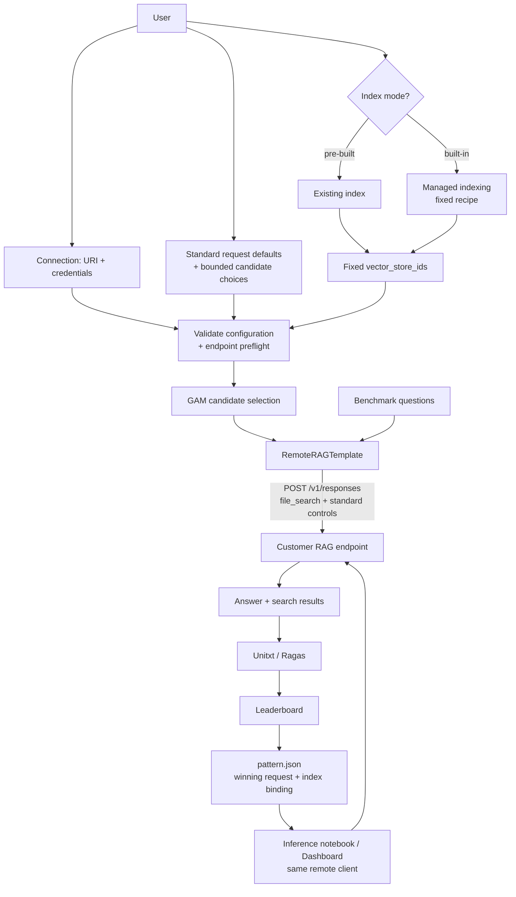

# Open Data Hub - AutoRAG Custom RAG (Responses + file_search Contract)

|                |            |
| -------------- | ---------- |
| Date           | 2026-10-12 |
| Scope          | AutoRAG Component |
| Status         | Proposed |
| Authors        | Lukasz Cmielowski |
| Supersedes     | N/A |
| Superseded by: | N/A |
| Tickets        | |
| Other docs:    | [ODH-ADR-0001](./ODH-ADR-0001-autorag.md) · [ODH-ADR-0003](./ODH-ADR-0003-rag-templates.md) · [ODH-ADR-0004](./ODH-ADR-0004-rag-pattern-inference.md) · [ODH-ADR-0005](./ODH-ADR-0005-rag-pattern-evaluation.md) · [ODH-ADR-0006](./ODH-ADR-0006-mlflow-integration.md) |

## What

Allow AutoRAG users to optimize customer-hosted RAG services through a defined subset of the **Responses API and `file_search` contract**. The endpoint owns retrieval and generation; AutoRAG owns experiment orchestration, evaluation, ranking, artifacts, and MLflow integration.

In v1, AutoRAG varies only supported, documented Responses and `file_search` request parameters. It does not accept endpoint-specific parameter schemas, request mappings, custom response envelopes, or function-call execution delegated to AutoRAG.

ai4rag provides a `RemoteRAGTemplate` (`BaseRAGTemplate` subclass) for this contract. Optimization operates against a fixed index, supplied by the customer or prepared through the built-in documents indexing pipeline.

## Why

Customers often already run proprietary retrieval, reranking, agents, or generation behind an HTTP API. A standard external contract lets AutoRAG optimize these services without importing customer code or knowing their implementation.

A bounded Responses + `file_search` contract:

* Reuses the inference wire format in [ODH-ADR-0004](./ODH-ADR-0004-rag-pattern-inference.md).
* Provides a known parameter vocabulary and result structure for AutoRAG and the Dashboard.
* Fits RHOAI Connections (`uri` + credentials).
* Supplies retrieved passages and document identity for Unitxt / Ragas evaluation.
* Keeps customer dependencies and tool execution outside the AutoRAG image.

The endpoint may use custom functions or agent flows internally. It must expose the agreed request controls and file-search results externally. Compatibility describes the HTTP contract; it does not require using OpenAI-hosted storage or models.

## Goals

* Optimize remote retrieve-and-generate services through one Responses + `file_search` contract.
* Use `RemoteRAGTemplate` and a Connection parameter (`custom_rag_secret_name`).
* Support pre-built indexes and indexes prepared by the built-in pipeline.
* Explore a bounded search space over an explicit allowlist of standard request fields.
* Preserve evaluator-qualified metrics, leaderboards, `pattern.json`, and MLflow parent/child runs.
* Reuse the winning request configuration for inference, keeping credentials as Connection references.

## Non-Goals (v1)

* Full Responses API coverage, streaming, or server-side conversation management.
* Endpoint-specific optimization parameters, custom JSON Schemas, arbitrary REST adapters, or custom response envelopes.
* Returning unfinished function calls for AutoRAG to execute and resume.
* Optimizing chunking, embedding models, index construction, or proprietary agent settings through the remote request contract.
* Custom ingestion APIs on the endpoint, including Files / Vector Stores upload APIs.
* OCI custom template workers, customer Python hooks, or Papermill execution inside optimization.
* Guaranteeing endpoint availability or answer quality, or supporting customer implementation internals.

## How

### Ownership boundary

| Responsibility | Owner |
| --- | --- |
| Retrieval, generation, internal agents and tool execution | Customer endpoint |
| GAM, benchmark handling, Unitxt / Ragas, leaderboard, and artifacts | AutoRAG |
| Index preparation | Built-in platform pipeline or customer tooling |
| Mapping the prepared index to `file_search.vector_store_ids` | Customer endpoint / deployment integration |
| Connection authorization and network reachability | User / platform |

### Pipeline surface

| Parameter | Role |
| --- | --- |
| `custom_rag_secret_name` | Connection to the endpoint (`uri`, API key / token). |
| `custom_rag_config` | Non-secret run configuration: standard request defaults, candidate choices for supported fields, and optional document-id mapping. |

`custom_rag_config` replaces an endpoint-specific template manifest. AutoRAG owns the field definitions and validation; customers supply values and candidate choices, not schemas or mapping expressions. A [Template Builder](./ODH-ADR-0008-custom-rag-template-builder.md) may produce a conforming endpoint and this run configuration, but its authoring metadata does not extend the v1 optimization contract.

The user also selects an index mode and supplies its existing corpus / store inputs. Benchmark, objective, budget, and evaluator settings follow the normal AutoRAG pipeline.

### Supported optimization parameters

The v1 compatibility profile is named `responses.file_search.v1`. It defines the following allowlist from the [Responses API reference](https://developers.openai.com/api/reference/python/resources/responses/methods/create):

| Request field | v1 treatment |
| --- | --- |
| `tools[0].max_num_results` | Required retrieval control; fixed value or finite candidate choices. Limits returned search results, not index construction. |
| `tools[0].ranking_options.score_threshold` | Optional candidate choices, within the documented range of 0–1. |
| `tools[0].ranking_options.ranker` | Optional choices among documented ranker identifiers supported by the endpoint. Proprietary reranker names are outside v1. |
| `model` | Fixed model id or finite candidate choices supported by the endpoint. |
| `temperature` or `top_p` | Optional candidate choices where the selected model supports them; vary at most one per experiment. |
| `max_output_tokens` | Fixed output-token budget or finite candidate choices. |
| `instructions` | Fixed instructions or an explicit set of candidate instruction strings. |

The following fields are fixed controls, not optimization dimensions:

* `tools` contains exactly one tool, with `type: "file_search"`.
* `tools[0].vector_store_ids` binds the prepared index and remains unchanged across candidates.
* Optional `tools[0].filters` expresses the experiment's corpus / access constraints and remains unchanged across candidates. Endpoint authorization remains mandatory.
* AutoRAG supplies `input`, `stream: false`, `store: false`, `tool_choice: {"type": "file_search"}`, and `include: ["file_search_call.results"]`.
* Each benchmark question is evaluated independently; conversation ids and previous-response state are not used.

Fields outside this allowlist are not accepted in v1 run configuration. Extending the supported subset requires an explicit profile revision; newly documented API fields do not automatically become search dimensions.

The endpoint must honor the required controls and every optional field selected for the experiment, using the documented semantics. Unsupported parameters or values must produce a clear validation error rather than be silently ignored. AutoRAG validates permitted values and model-specific combinations before optimization; a successful HTTP response alone cannot prove that a control affects endpoint behavior.

### Run configuration

`request` supplies standard request defaults. `search_space` mirrors the allowed request fields, replacing searchable values with finite candidate lists; its single tool entry retains the `file_search` discriminator. Request fields omitted from `search_space` stay fixed. Types and bounds come from AutoRAG's built-in profile, and the selected search space is persisted with the run.

```json
{
  "request": {
    "model": "customer-rag",
    "temperature": 0.2,
    "max_output_tokens": 1024,
    "tools": [{
      "type": "file_search",
      "vector_store_ids": ["warranty-documents"],
      "max_num_results": 10,
      "ranking_options": {"score_threshold": 0.0}
    }]
  },
  "search_space": {
    "temperature": [0.0, 0.2],
    "tools": [{
      "type": "file_search",
      "max_num_results": [5, 10, 20],
      "ranking_options": {"score_threshold": [0.0, 0.2]}
    }]
  },
  "document_keys": {"file-manual": "product-manuals/xr-200-manual.pdf"}
}
```

`document_keys` is optional when returned file ids already equal canonical benchmark document keys. Otherwise it maps endpoint-local `file_id` values to those keys. It is evaluation metadata and is not sent as a proprietary endpoint field. Secrets, endpoint URLs, headers, and Connection credentials do not belong in this configuration.

### ai4rag: `RemoteRAGTemplate`

```text
BaseRAGTemplate
  └── RemoteRAGTemplate   # Responses + file_search HTTP client
```

Responsibilities:

* `parameter_schema()` exposes the built-in profile restricted to the configured candidate choices; it does not load customer schemas or discover arbitrary endpoint parameters.
* `run(question, settings, …)` sends one standard request, validates the response, and returns normalized `answer`, `answer_contexts[]`, and status/error for AutoRAG evaluators.
* Index construction and internal tool execution remain outside this client.

Patterns use `template_id: "custom:remote_responses"`.

### Wire contract

The endpoint base URL and authentication come from the Connection:

```http
POST {uri}/v1/responses
Authorization: Bearer <token>
Content-Type: application/json
```

For example, one candidate produces:

```json
{
  "model": "customer-rag",
  "input": "What warranty period applies to the XR-200 controller?",
  "temperature": 0.2,
  "max_output_tokens": 1024,
  "stream": false,
  "store": false,
  "tool_choice": {"type": "file_search"},
  "tools": [{
    "type": "file_search",
    "vector_store_ids": ["warranty-documents"],
    "max_num_results": 10,
    "ranking_options": {"score_threshold": 0.0}
  }],
  "include": ["file_search_call.results"]
}
```

A successful response has `object: "response"`, `status: "completed"`, completed `file_search_call` output with included results, and a final assistant message containing `output_text`. The endpoint completes retrieval and generation within this call; AutoRAG does not execute function calls returned by the service.

```json
{
  "id": "resp_example",
  "object": "response",
  "status": "completed",
  "model": "customer-rag",
  "output": [
    {
      "id": "fs_example",
      "type": "file_search_call",
      "status": "completed",
      "queries": ["XR-200 warranty period"],
      "results": [{
        "file_id": "file-manual",
        "filename": "xr-200-manual.pdf",
        "text": "Warranty: 24 months from purchase date.",
        "score": 0.9
      }]
    },
    {
      "id": "msg_example",
      "type": "message",
      "role": "assistant",
      "status": "completed",
      "content": [{
        "type": "output_text",
        "text": "The warranty period is 24 months.",
        "annotations": [{
          "type": "file_citation",
          "file_id": "file-manual",
          "filename": "xr-200-manual.pdf",
          "index": 0
        }]
      }]
    }
  ],
  "usage": {"input_tokens": 120, "output_tokens": 20, "total_tokens": 140}
}
```

The client concatenates the final assistant message's text blocks to produce `answer`. Included search-result text becomes `answer_contexts[]`; each `file_id` must resolve to a canonical `document_key` in the benchmark's `correct_answer_document_keys` namespace ([ODH-ADR-0002](./ODH-ADR-0002-experiment-settings.md#benchmark-json)). Keys identify full source object paths, not basenames or chunk ids. File citations alone cannot replace retrieved text or document identity ([OpenAI file-search contract](https://developers.openai.com/api/docs/guides/tools-file-search)).

Evaluation artifacts record `context_source: "retrieval_results"`: returned search results do not prove exactly which passages generation consumed. Preserve search-call identity, queries, result order, scores, and repeated passages. Multi-step search results must not be presented as one global ranking; rank-based metrics are unavailable unless the evaluator supports the step structure.

A completed search call with `results: []` is a valid no-results outcome. Missing search calls, missing or invalid result data, ambiguous answers, and unsuccessful responses are failures. Failed benchmark responses remain visible; candidates with incomplete evaluation are excluded from normal ranking. AutoRAG computes evaluator scores locally and never treats endpoint-provided scores as Unitxt / Ragas metrics.

Before GAM starts, send one representative benchmark question and require HTTP 200, a completed answer, included search results, and resolvable document identities. Validate the selected request fields as well as the response. A health or models endpoint alone does not establish conformance. The endpoint returns standard Responses usage and error information where applicable; unavailable usage is not recorded as zero.

### Index modes

| Mode | User provides | AutoRAG behavior |
| --- | --- | --- |
| Pre-built | Index ids the endpoint can query and document-id mapping where needed. | Reuse the existing index unchanged across candidates; record its binding in the pattern. |
| Built-in pipeline | Corpus and database Connections, plus a fixed built-in indexing configuration compatible with the endpoint. | Prepare the index through the managed documents indexing pipeline, then bind it through `vector_store_ids` before remote optimization. |

In both modes the index remains fixed throughout the remote experiment. The endpoint must interpret the provided ids as bindings to that prepared store, with compatible collection and embedding settings. Database credentials remain deployment Connections, not Responses request fields. Index recipe selection or optimization belongs to the separate built-in platform flow, not this remote search space.

For promotion with a built-in index, the managed pipeline may prepare the full-corpus index using the recorded recipe. If this produces different store ids, record the replacement binding before inference and retain it with the promoted pattern. This is an explicit index-binding update, not a change to the winning query or generation parameters. Pre-built indexes remain customer-managed.

### End-to-end flow



### User experience

1. Deploy or select a conforming RAG service and create its Connection.
2. Select a prepared index, or configure the built-in indexing pipeline to prepare one the service can query.
3. In the AutoRAG wizard, choose **Custom (Responses + file_search)**, select the Connection, and configure fixed values and candidate choices from the standard field allowlist. Supply document-id mapping if needed.
4. Choose the benchmark, objective, and budget. Validate the configuration and endpoint before starting GAM.
5. Inspect the leaderboard and retrieved contexts, then promote the winning request configuration for remote inference.

The wizard uses AutoRAG-owned field definitions; no customer manifest editor or custom parameter form is needed.

### Artifacts and MLflow

Custom patterns extend [ODH-ADR-0004](./ODH-ADR-0004-rag-pattern-inference.md) with a remote inference variant. Evaluation and MLflow retain [ODH-ADR-0005](./ODH-ADR-0005-rag-pattern-evaluation.md) / [ODH-ADR-0006](./ODH-ADR-0006-mlflow-integration.md).

* `template_id: "custom:remote_responses"` and `inference.kind: "remote_responses"` select remote invocation. No built-in deployment `runtime_spec` is generated.
* `settings.request` records the complete effective non-secret winning request, excluding the per-question `input`. Its `vector_store_ids` are the authoritative remote index binding.
* `inference.remote_spec` records the compatibility profile, Connection reference, and document-id mapping. There is no endpoint-specific manifest or proprietary response profile.
* `indexing.mode: "prebuilt"` omits `pipeline_spec`. `indexing.mode: "builtin"` records the managed recipe and `pipeline_spec` used to prepare the index.
* Run artifacts preserve the selected search space; evaluation artifacts preserve result semantics, search steps, and candidate completeness.
* Child MLflow runs record the profile, Connection name, non-secret settings, metrics, and artifact references. Credentials are never logged.

The following is the custom-specific portion of a pre-built-index `pattern.json`; normal identity, iteration, duration, and evaluation fields remain required:

```json
{
  "template_id": "custom:remote_responses",
  "settings": {
    "request": {
      "model": "customer-rag",
      "temperature": 0.2,
      "max_output_tokens": 1024,
      "stream": false,
      "store": false,
      "tool_choice": {"type": "file_search"},
      "tools": [{
        "type": "file_search",
        "vector_store_ids": ["warranty-documents"],
        "max_num_results": 10,
        "ranking_options": {"score_threshold": 0.0}
      }],
      "include": ["file_search_call.results"]
    }
  },
  "indexing": {"mode": "prebuilt"},
  "inference": {
    "kind": "remote_responses",
    "remote_spec": {
      "profile": "responses.file_search.v1",
      "connections": {"custom_rag_secret_name": "customer-rag"},
      "document_keys": {"file-manual": "product-manuals/xr-200-manual.pdf"}
    }
  }
}
```

Optimization, generated inference notebooks, and Dashboard testing use the **same profile-aware HTTP client and result normalization**. Inference supplies a new question and the saved request settings, resolving credentials through authorized Connection references. Exported patterns retain the configuration and document-id mapping. The saved configuration does not prove that the remote implementation or index has remained unchanged.

| Consumer / artifact | Remote-pattern behavior in v1 |
| --- | --- |
| `inference_notebook.ipynb` | Calls the existing endpoint using the saved request and profile. |
| Dashboard test endpoint | Dispatches through the shared remote client. |
| `indexing_notebook.ipynb` | Generated for built-in index mode; omitted for externally managed pre-built indexes. |
| `starter_kit.zip` | Not generated for remote patterns; the endpoint is already deployed. |
| One-click deployment | Unavailable for remote patterns; Dashboard presents remote invocation. |

These consumers must support the remote discriminator before custom patterns are enabled. Generated starter kits intended for use as remote templates must also implement this profile, including the request controls and native search-result output.

### Support boundary

| Platform supports | Customer owns |
| --- | --- |
| Connection handling, remote client, GAM, evaluators, and artifacts | Endpoint implementation, internal tools, availability, and answer quality |
| Validation of the standard request subset and required search results | Honoring selected controls and exposing conforming responses |
| Built-in index pipeline behavior | Pre-built index correctness and endpoint-to-store configuration |

## Alternatives

| Alternative | Decision |
| --- | --- |
| Responses + `file_search` subset with built-in or pre-built indexes | **Selected:** One wire contract and bounded search space; custom logic stays behind the endpoint. |
| Generic parameter manifest and custom response extensions | **Deferred:** More flexibility, but requires endpoint-specific schemas, mappings, UI, and normalization. |
| Arbitrary REST adapters or externally executed function tools | **Deferred:** Adds protocol mapping or tool-loop ownership to AutoRAG. Internal endpoint function calling remains allowed. |
| Custom Files / Vector Stores ingestion APIs | **Deferred:** A separate index protocol is not needed for inference-time optimization. |
| OCI workers or notebook execution inside optimization | **Deferred:** Adds customer-code execution and dependency management to the optimization runtime. |
| Broader built-in configuration only | **Insufficient alone:** Does not support existing proprietary RAG services. |

## Risks

* Endpoint ignores standard controls → require documented support and validate selected fields; surface unsupported values as errors.
* Missing or unresolvable search results → fail conformance rather than evaluate fabricated contexts.
* Index and endpoint disagree on collection or embedding configuration → validate compatibility before optimization.
* Endpoint or index changes after optimization → preserve the winning request and binding; implementation/index immutability remains an external obligation.
* Provider-specific rankers or score distributions → tune only documented supported controls; compare candidates through local evaluator metrics, not raw retrieval scores.

## Follow-on

* Additional documented Responses controls through explicit profile revisions.
* Endpoint implementation / index fingerprints for stricter promotion checks.
* Custom parameter schemas, response adapters, or ingestion APIs only if the fixed contract proves insufficient.
* A separately scoped Template Builder that produces endpoints conforming to this profile.

## Related

* [AutoRAG architecture](./ODH-ADR-0001-autorag.md)
* [Optimization settings and benchmark identity](./ODH-ADR-0002-experiment-settings.md)
* [RAG templates](./ODH-ADR-0003-rag-templates.md)
* [RAG pattern inference](./ODH-ADR-0004-rag-pattern-inference.md)
* [RAG pattern evaluation](./ODH-ADR-0005-rag-pattern-evaluation.md)
* [MLflow integration](./ODH-ADR-0006-mlflow-integration.md)
* [Custom RAG Template Builder](./ODH-ADR-0008-custom-rag-template-builder.md)
* [OpenAI Responses API](https://developers.openai.com/api/reference/python/resources/responses/methods/create) · [File search](https://developers.openai.com/api/docs/guides/tools-file-search)
