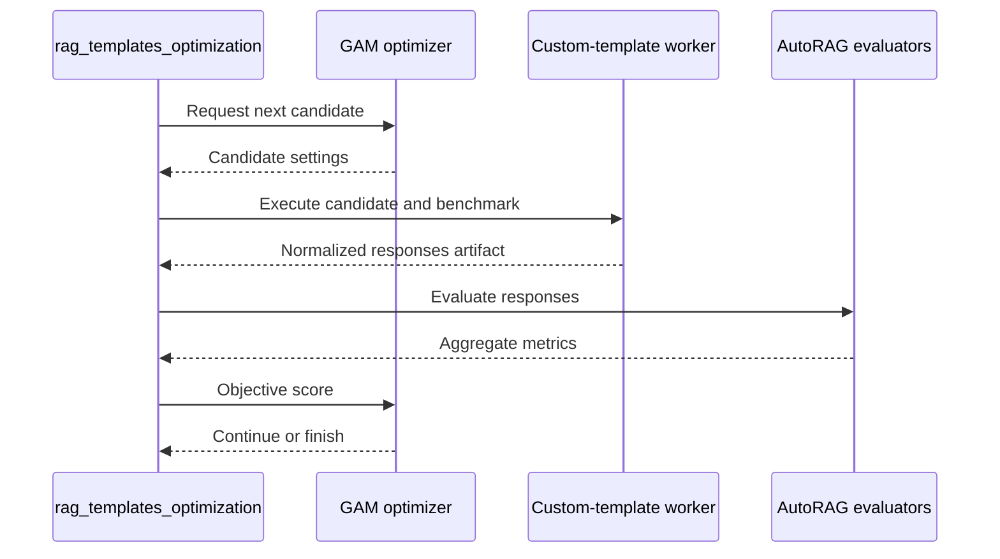

# Open Data Hub - AutoRAG Custom RAG Templates

|                |            |
| -------------- | ---------- |
| Date           | 2026-10-12 |
| Scope          | AutoRAG Component |
| Status         | Proposed |
| Authors        | Lukasz Cmielowski |
| Supersedes     | N/A |
| Superseded by: | N/A |
| Tickets        | |
| Other docs:    | [ODH-ADR-0001](./ODH-ADR-0001-autorag.md) · [ODH-ADR-0003](./ODH-ADR-0003-rag-templates.md) · [ODH-ADR-0004](./ODH-ADR-0004-rag-pattern-inference.md) · [ODH-ADR-0005](./ODH-ADR-0005-rag-pattern-evaluation.md) · [ODH-ADR-0006](./ODH-ADR-0006-mlflow-integration.md) |

## What

Allow AutoRAG users to supply a custom RAG template for optimization. A custom template implements the ai4rag `BaseRAGTemplate` contract and is executed by the AutoRAG Kubeflow Pipeline (KFP) in the user's project. AutoRAG continues to own experiment orchestration, evaluation, ranking, artifacts, and MLflow integration.

The custom template is a versioned, immutable reference to user code plus a manifest. It describes the RAG composition and valid search space; AutoRAG optimizes values within that composition. The implementation may use a workflow other than the built-in SimpleRAG or AgenticRAG templates.

## Why

Built-in SimpleRAG, AgenticRAG, and their Vector and Graph variants cover common patterns, but customers may need proprietary retrievers, rerankers, tools, prompts, agent workflows, or domain-specific indexing and generation logic. They need to evaluate and optimize those implementations against their own corpus and benchmark without reimplementing the AutoRAG experiment lifecycle.

AutoRAG is already a KFP workload that runs user code in the user's project. Custom-template support should therefore be a first-class bring-your-own-code workflow. The primary platform concern is a clear contract and reproducibility of an optimized pattern, not preventing users from running their own code in their own namespace.

## Goals

* Let a user optimize an implementation derived from `BaseRAGTemplate`.
* Support a custom template executed either by a child workload in the user's namespace or by a customer-provided remote endpoint.
* Preserve the existing evaluator-qualified metrics, leaderboards, `pattern.json` envelope, and MLflow parent/child-run model.
* Allow template-specific, typed, bounded search-space dimensions.
* Pin the exact template implementation used for optimization, indexing, and inference.
* Provide a Dashboard and API flow that makes an approved or user-owned custom template as usable as a built-in template.
* Keep credentials as RHOAI Connection references; do not embed secrets in template packages or pattern artifacts.

## Non-Goals

* A no-code visual editor for arbitrary RAG or agent graphs.
* Automatically making every third-party RAG framework or template supported by Red Hat.
* Cross-tenant template sharing or a global public template marketplace.
* Changing the built-in template catalog or the evaluation metric definitions.
* Guaranteeing that an arbitrary user implementation is safe, performant, or compatible with a future template version.

## How

### Ownership boundary

| Responsibility | Owner |
| --- | --- |
| RAG composition, template-specific settings, retrieval/generation logic, optional tool use, and declared index/runtime behavior | Template author |
| Pipeline execution, candidate orchestration, benchmark handling, optimization budget, scoring, leaderboard, and result selection | AutoRAG |
| Evaluator-qualified metrics and `evaluation_results.json` / `pattern.json` schemas | AutoRAG |
| Template package, dependencies, version, and compatibility declaration | Template author |
| Connections, project access, and execution identity | User / platform |

The template may add namespaced fields to its settings, but it must not replace the common pattern artifact envelope or evaluation result contract. This keeps custom and built-in patterns comparable in the Dashboard, KFP artifacts, and MLflow.

### Template contract

Custom templates inherit from `BaseRAGTemplate`. The exact ai4rag Python signatures are implementation details; the stable AutoRAG contract has the following responsibilities:

```python
class BaseRAGTemplate:
    # Identity and compatibility
    template_id: str
    template_version: str
    api_version: str

    def manifest(self) -> TemplateManifest: ...
    def parameter_schema(self) -> JSONSchema: ...
    def validate(self, settings, environment) -> ValidationResult: ...

    # Optimization and inference
    def build(self, settings, runtime_context) -> RAGApplication: ...
    def run(self, question, settings, runtime_context) -> RAGResponse: ...

    # Required when the template owns index construction or deployment export
    def indexing_spec(self, settings, runtime_context) -> PipelineSpec: ...
    def runtime_spec(self, settings, runtime_context) -> RuntimeSpec: ...
```

`parameter_schema()` declares user-editable settings, defaults, types, constraints, and whether a field is fixed, searchable, indexing-time, or inference-time. AutoRAG uses it to validate the request and construct template-specific UI and API fields. The pipeline varies only declared searchable fields.

`run()` executes one benchmark question with an optimizer-selected candidate configuration. It must return the normalized data needed for evaluation: generated answer, retrieved contexts with stable document identity, and failure information. It may additionally return latency, token usage, citations, and tracing data. AutoRAG computes and records evaluation metrics; a template cannot redefine the meaning of a standard metric.

The manifest declares at least the template identity, `BaseRAGTemplate` API version, entry point, supported store/provider capabilities, parameter schema, runtime image reference, and required Connection *types*. It must not contain connection values or secrets. It is static metadata: the Dashboard and BFF read it without importing or executing customer Python.

### Template reference and reproducibility

The pipeline receives a `template_ref`, not a Python object. A reference identifies static metadata separately from the image that executes the implementation, for example:

```yaml
template_ref:
  manifest_uri: oci://quay.io/acme/policy-rag-template-manifest@sha256:0123...
  runtime_image: quay.io/acme/policy-rag-runtime@sha256:4567...
  entrypoint: acme_rag.templates.PolicyRAGTemplate
  api_version: v1
```

The runtime image extends a release-compatible AutoRAG template-runtime base and contains the custom template with all of its Python and system dependencies. An immutable OCI digest is the recommended production reference. A wheel or source bundle stored in project-accessible object storage, or a Git repository pinned to a commit SHA, can support developer workflows when a resolved, immutable runtime image is built before optimization. A mutable tag or branch is not a valid promoted-pattern reference.

The resolved template identity is recorded in `pattern.json` in addition to the existing `template_id`: reference type, immutable location/digest or commit, entry point, template version, and `api_version`. Full-corpus indexing and serving must use that same resolved identity. Publishing a new template version does not change existing patterns; users re-run optimization and promote a new pattern when they choose to adopt it.

### KFP execution model

`rag_templates_optimization` remains the platform-owned orchestration component and runs in the standard AutoRAG backend image. It does not import the custom template or its dependencies. Before a run, the BFF or API resolves the static manifest, validates the template API version and requested Connections, and uses `parameter_schema()` metadata to render template-specific controls.

For each candidate selected by GAM, the orchestrator creates a child custom-template execution workload in the user's namespace. The workload uses the pinned `runtime_image`, imports the declared `BaseRAGTemplate` entry point, and executes the candidate against the benchmark rows. It writes a normalized result artifact and a compact completion manifest to the run's object-storage location. The orchestrator waits for completion, reads the artifact, evaluates the results with the standard AutoRAG evaluators, and feeds the aggregate objective score back to GAM.

The custom template is an execution worker, not an optimizer or the authority for standard metric values:



The result artifact identifies the candidate and effective settings and contains one normalized response per benchmark row. Each response includes at least `question`, `answer`, `answer_contexts[]` with stable `document_key`, and status/error data. Optional fields include citations, latency, token usage, and tracing references. The worker may return namespaced custom metrics, but the orchestrator calculates the standard Unitxt, Ragas, and derived metrics used for ranking.

The logical model is one worker execution per candidate. The physical model may be one Kubernetes Job per candidate, a long-lived worker for an optimization run, or bounded batches when the optimizer supports them. Every model must preserve the request/result artifact contract and must allow GAM to receive scores before selecting the next adaptive candidate. Implementations should avoid one new workload per benchmark row.

The normal namespace and service-account boundary applies. The orchestration component needs narrowly scoped permission to create, read, and clean up the child workload in its namespace; the child runs with the user's permitted project identity. Custom-template support does not grant access beyond what the user could already run through a KFP workload in that project. Runtime policy may still restrict images, package locations, resource limits, network access, and permitted Connection types.

### Remote endpoint execution backend

A custom template may instead be implemented by a customer-provided REST endpoint. This is an execution backend, not a replacement for AutoRAG orchestration: `rag_templates_optimization` still selects candidates, waits for execution results, evaluates normalized responses, and supplies scores to GAM.

The endpoint uses an asynchronous, candidate-level protocol. The submit request contains a run and candidate identity, effective settings, a benchmark artifact URI, and non-secret Connection references. The endpoint returns an execution ID; AutoRAG polls its status endpoint until it returns a compact completion manifest with the normalized responses artifact URI.

```text
POST /v1/executions
GET  /v1/executions/{execution_id}
```

The responses artifact has the same normalized row contract as a child workload: `question`, `answer`, `answer_contexts[]` with stable `document_key`, status/error data, and optional citations, timing, token usage, and trace references. The endpoint does not return the authoritative standard score; AutoRAG applies Unitxt, Ragas, and derived evaluators after reading the artifact.

The endpoint URL and authentication configuration are supplied through a namespace-scoped Connection. The endpoint manages its own dependencies, scaling, and access to any customer-owned data plane. The resolved pattern records an immutable runtime fingerprint returned by the endpoint—preferably a container image digest or signed release identifier—together with the endpoint template version. An endpoint that cannot provide an immutable fingerprint is not eligible for pattern promotion, because its optimized behavior cannot be reproduced.

### User experience

The Dashboard and API provide two related journeys.

#### Template author

1. Create a `BaseRAGTemplate` implementation from an SDK skeleton or a declarative-template starter.
2. Declare the manifest and parameter schema, then test with a small corpus and benchmark from a workbench or local environment.
3. Package the code and dependencies, publish an immutable reference, and retain the template version with the project.
4. Optionally make the template discoverable in the project or organization catalog according to platform policy.

#### AutoRAG user

1. Select **Custom RAG template** in the AutoRAG wizard or submit `template_ref` through the API.
2. Choose a project-owned or catalog template and version. AutoRAG resolves the manifest and shows its supported stores, required connection types, and template-specific controls.
3. Select the document corpus, benchmark, Connections, evaluation objective, and optimization budget. AutoRAG rejects incompatible stores, missing Connection types, and invalid values before creating the run.
4. Start the KFP optimization. The progress and results pages show the custom template name and pinned version alongside candidate settings, scores, latency, retrieved contexts, and traces.
5. Inspect a winning candidate and promote its pattern. The promoted pattern is pinned to the resolved template reference.
6. Run full-corpus indexing and deploy or invoke inference using the same template identity.

The common case is that an AutoRAG user selects a prepared template and never needs to understand container packaging or `BaseRAGTemplate`. Template authoring remains an engineering workflow.

### Artifact and observability integration

Custom patterns retain the standard artifacts defined in [ODH-ADR-0004](./ODH-ADR-0004-rag-pattern-inference.md): `pattern.json`, `evaluation_results.json`, notebooks, and the run-level leaderboard. `pattern.json` additionally records the resolved template reference and template-specific settings under a namespaced field.

MLflow continues to create one parent run for the KFP execution and one child run for each pattern ([ODH-ADR-0006](./ODH-ADR-0006-mlflow-integration.md)). Child-run tags include the template ID, version, and immutable reference. Standard aggregate metrics remain comparable across templates. Template-specific metrics may be logged with a template namespace but cannot collide with standard metric keys.

## Alternatives

### 1. Add more configuration to built-in templates

**Not selected:** This is useful for common use cases but cannot express proprietary agent workflows, retrievers, tools, or domain-specific implementations.

### 2. Declarative templates only

**Not selected as the sole approach:** A declarative composition can be a useful authoring path, but it limits customers to platform-provided primitives. It should compile or resolve to the same `BaseRAGTemplate` contract rather than replace it.

### 3. Remote customer-hosted RAG endpoint

**Supported execution backend:** It allows proprietary implementations and independently operated runtimes while retaining AutoRAG optimization and evaluation. It requires the asynchronous request/result artifact contract, endpoint authentication through a Connection, and an immutable runtime fingerprint to preserve reproducibility. A child workload remains the preferred option when the user wants a fully project-local workflow.

### 4. Copy custom code into every pipeline definition

**Not selected:** It duplicates implementation details, makes dependency management difficult, and cannot reliably identify what code produced a promoted pattern.

## Risks

* A custom template can have a large or expensive search space. The platform must expose and enforce candidate, duration, and resource budgets.
* Template dependencies may be unavailable or non-reproducible. Immutable package references and explicit dependency resolution are required for promotion.
* The static manifest and runtime image can drift. The resolved run record must bind the manifest digest, runtime-image digest, and entry point, and the worker must reject a mismatched manifest.
* Per-candidate child workloads add scheduling overhead and can fail independently. The orchestrator must enforce timeouts, surface child diagnostics, and clean up completed or failed workloads.
* A remote endpoint can change independently of an optimization run or become unavailable. The orchestrator must use idempotent execution IDs, enforce submit/poll timeouts and retries, record the endpoint runtime fingerprint, and reject promotion when the fingerprint is absent.
* A template can return malformed or incomplete retrieval data. Contract validation and clear pre-run errors are required; candidate-level failures must be visible in run artifacts.
* New template versions can change semantics. Existing patterns remain pinned, and adoption of a new version requires re-optimization.
* User code may use the permissions available to its KFP workload. Namespace isolation, Connection scoping, image/package policy, and resource limits remain platform responsibilities.

## Related

* [AutoRAG architecture](./ODH-ADR-0001-autorag.md)
* [RAG templates](./ODH-ADR-0003-rag-templates.md)
* [RAG pattern inference](./ODH-ADR-0004-rag-pattern-inference.md)
* [RAG pattern evaluation](./ODH-ADR-0005-rag-pattern-evaluation.md)
* [MLflow integration](./ODH-ADR-0006-mlflow-integration.md)
