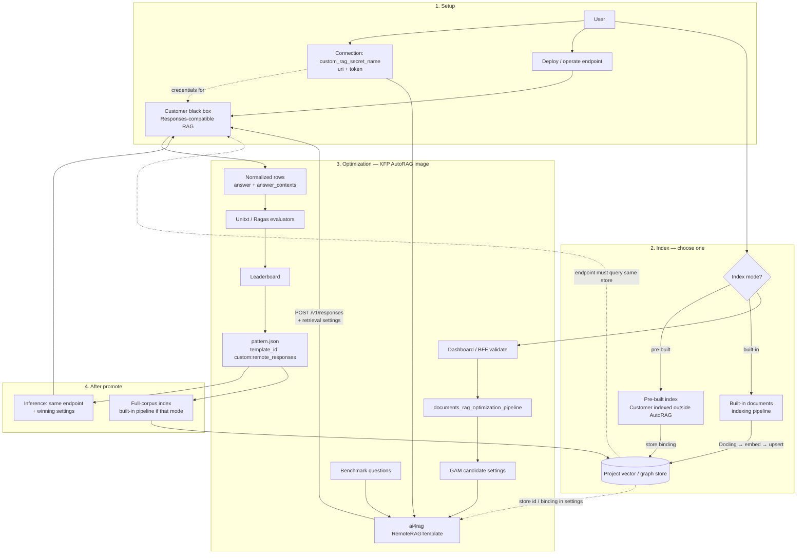

# Open Data Hub - AutoRAG Custom RAG (Remote Responses Endpoint)

|                |            |
| -------------- | ---------- |
| Date           | 2026-10-12 |
| Scope          | AutoRAG Component |
| Status         | Proposed |
| Authors        | Lukasz Cmielowski |
| Supersedes     | N/A |
| Superseded by: | N/A |
| Tickets        | |
| Other docs:    | [ODH-ADR-0001](./ODH-ADR-0001-autorag.md) · [ODH-ADR-0003](./ODH-ADR-0003-rag-templates.md) · [ODH-ADR-0004](./ODH-ADR-0004-rag-pattern-inference.md) · [ODH-ADR-0005](./ODH-ADR-0005-rag-pattern-evaluation.md) · [ODH-ADR-0006](./ODH-ADR-0006-mlflow-integration.md) |

## What

Allow AutoRAG users to optimize **custom retrieval and generation** implemented behind a customer-hosted, **OpenAI Responses–compatible** black-box endpoint. AutoRAG continues to own experiment orchestration, evaluation, ranking, artifacts, and MLflow integration.

ai4rag provides a `RemoteRAGTemplate` (`BaseRAGTemplate` subclass) that wraps that endpoint. **Indexing is not custom in v1:** the index is either already built and supplied to the run, or built with the **built-in** documents indexing pipeline.

## Why

Built-in SimpleRAG / AgenticRAG cover common patterns, but customers often already run proprietary retrieve-and-generate stacks (agents, rerankers, tools, domain logic) behind an HTTP API. Forcing OCI template packages, in-cluster workers, or custom index builders is heavy for v1.

A Responses-compatible black box:

* Reuses the same wire shape AutoRAG already uses for inference ([ODH-ADR-0004](./ODH-ADR-0004-rag-pattern-inference.md))
* Fits RHOAI Connections (`uri` + credentials)
* Keeps Unitxt / Ragas and `pattern.json` comparable to built-in runs
* Avoids shipping and supporting arbitrary customer Python in the AutoRAG image

Indexing stays on the platform path (or pre-built) so AutoRAG does not need a second custom index protocol in v1.

## Goals

* Optimize custom retrieve-and-generate via a Responses-compatible remote endpoint.
* Integrate through ai4rag `RemoteRAGTemplate` and a pipeline Connection parameter (`custom_rag_secret_name`).
* Support two index modes: **pre-built index provided to the run**, or **built-in indexing pipeline**.
* Preserve evaluator-qualified metrics, leaderboards, `pattern.json`, and MLflow parent/child runs.
* Allow a bounded, typed search space over request/settings knobs the endpoint honors.
* Keep credentials as Connection references only.

## Non-Goals (v1)

* Custom index-building APIs on the black box (Files / Vector Stores upload owned by the customer endpoint).
* OCI custom template images, in-cluster long-lived workers, or Papermill-as-template packaging.
* Declarative composition editors or in-process plugin wheels.
* Guaranteeing safety, performance, or correctness of the customer endpoint.
* Red Hat Support debugging customer retrieval/generation logic behind the endpoint.

## How

### Ownership boundary

| Responsibility | Owner |
| --- | --- |
| Retrieve-and-generate implementation (any stack) behind Responses-compatible HTTP | Customer endpoint |
| GAM / candidate orchestration, benchmark handling, Unitxt / Ragas, leaderboard, `pattern.json` | AutoRAG |
| Index corpus into a store the endpoint can query — **built-in pipeline** or **customer pre-build** | Platform built-in **or** customer (outside AutoRAG) |
| Connection (`uri`, credentials), network reachability from the pipeline | User / platform |

### Pipeline surface

New / primary parameter for custom mode:

| Parameter | Role |
| --- | --- |
| `custom_rag_secret_name` | Connection to the Responses-compatible endpoint (`uri`, API key / token) |

Index-related inputs (existing patterns; exact names follow [ODH-ADR-0002](./ODH-ADR-0002-experiment-settings.md) / indexing pipeline):

| Mode | User provides |
| --- | --- |
| **Pre-built index** | Store / collection binding the endpoint already uses (e.g. vector store id, Connection to DB + collection name). Optimization assumes the index is ready; AutoRAG does not build it. |
| **Built-in index** | Corpus Connections + run the managed **documents indexing pipeline** with built-in extraction/embedding/upsert. The remote endpoint must be configured to query that resulting store (same project Connections / collection the pattern records). |

Custom mode does **not** accept a custom indexing implementation in v1.

### ai4rag: `RemoteRAGTemplate`

```text
BaseRAGTemplate
  └── RemoteRAGTemplate   # HTTP client to Responses-compatible endpoint
```

Responsibilities:

* `parameter_schema()` — declares searchable / fixed knobs that map onto Responses request fields and any documented endpoint extensions (model, temperature, `max_num_results`, ranking options, etc.).
* `run(question, settings, …)` — calls the endpoint (typically `POST {uri}/v1/responses` with retrieval tool / file_search–equivalent and generation settings), returns normalized `answer`, `answer_contexts[]` with stable `document_key`, and status/error for AutoRAG evaluators.
* Does **not** own index construction; validates that required store binding / Connection refs for the chosen index mode are present.

`template_id` for patterns: `custom:remote_responses` (or `custom:<name>` when multiple remote templates are registered later).

### Wire contract (Responses-compatible)

The endpoint base URL and auth come from `custom_rag_secret_name`. The supported v1 predict path is OpenAI-compatible **Responses** with retrieval, aligned with platform inference:

```http
POST {uri}/v1/responses
Authorization: Bearer <token>
```

Request includes the user question, generation settings, and retrieval configuration (e.g. `file_search` / vector store ids, `max_num_results`, ranking). Response must yield:

* Generated answer text
* Retrieved contexts (via response `include` of search results, citations/annotations, or an agreed Responses-compatible extension) mappable to AutoRAG’s `answer_contexts[]` / `document_key`

AutoRAG does **not** treat the endpoint as the authority for Unitxt / Ragas scores; it evaluates the normalized rows locally.

Optional but recommended: `GET {uri}/v1/models` or health for preflight. Full OpenAI Vector Stores / Files **index** APIs on the black box are **out of scope for v1** (see Non-Goals).

### End-to-end flowchart



### Index modes

| Mode | When to use | AutoRAG behavior |
| --- | --- | --- |
| Pre-built | Customer already indexed with their own tooling; endpoint is bound to that store | Optimization only; pattern records the provided store binding; no custom index step |
| Built-in pipeline | Customer wants platform Docling / embed / upsert | Run managed indexing with **built-in** template settings compatible with the store; pattern’s `indexing` points at the built-in pipeline spec; endpoint must read that store at predict time |

**Constraint:** If HPO varies **index-time** dimensions (chunk size, embedding model, …), pre-built mode cannot explore them unless the user rebuilds the index outside AutoRAG between runs. Prefer varying **query-time / generation** knobs when using a remote retrieve-and-generate endpoint against a fixed index.

### Optimization flow

1. User selects custom / remote template and `custom_rag_secret_name`.
2. User chooses index mode: supply store binding **or** configure built-in indexing inputs.
3. BFF validates Connection, endpoint reachability, and index-mode prerequisites.
4. KFP optimization runs in the standard AutoRAG image; `RemoteRAGTemplate` calls the endpoint per benchmark question for each GAM candidate.
5. AutoRAG scores with standard evaluators and emits `pattern.json` with `template_id`, remote Connection ref (name only), effective settings, store binding, and evaluation block.
6. Promote pattern → inference uses the same Responses-compatible endpoint + settings; full-corpus index uses built-in pipeline if that mode was chosen, or assumes the pre-built store remains valid.

No child custom-template Jobs and no import of customer Python into the orchestrator image.

### User experience

1. Deploy or point to a Responses-compatible RAG service; create a Connection (`uri` + token).
2. Ensure an index exists (customer-built) **or** plan to run the built-in indexing pipeline against a supported store the service queries.
3. In AutoRAG wizard: choose **Custom (remote Responses)**, pick the Connection, set index mode, corpus/benchmark, objective, budget.
4. Run optimization; inspect leaderboard and contexts as with built-in templates.
5. Promote pattern; invoke inference against the same endpoint; index full corpus with built-in pipeline when applicable.

### Artifacts and MLflow

Same envelope as [ODH-ADR-0004](./ODH-ADR-0004-rag-pattern-inference.md) / [ODH-ADR-0006](./ODH-ADR-0006-mlflow-integration.md):

* `pattern.json` records `template_id`, `custom_rag_secret_name` (reference), store binding, settings, evaluation.
* Child MLflow runs tag the remote template id and Connection name (never secrets).
* Standard metrics remain comparable to built-in templates.

### Support boundary

| Platform supports | Customer owns |
| --- | --- |
| Connection handling, `RemoteRAGTemplate` client, GAM, evaluators, built-in indexing, artifacts | Endpoint implementation, availability, and answer quality |
| Contract validation (auth failures, malformed responses, missing contexts) | Mapping their stack to Responses-compatible requests/responses |
| Built-in index pipeline behavior | Pre-built index correctness and endpoint↔store configuration |

## Alternatives

### 1. Responses-compatible remote endpoint + built-in or pre-built index (selected)

**Selected for v1:** Lowest packaging cost, OpenShift/KFP-friendly, reuses inference wire format, keeps AutoRAG eval ownership. Custom logic stays entirely behind the customer service.

### 2. Custom index API on the black box (OpenAI Files / Vector Stores)

**Deferred:** Useful later if the endpoint should own ingestion. v1 avoids dual index ownership and OpenAI vector-store semantics that may not match customer Milvus/pgvector layouts.

### 3. OCI custom template + in-cluster worker

**Deferred:** Maximum flexibility for in-process `BaseRAGTemplate` code; high UX and ops cost (images, Jobs, deps). Revisit if remote Responses cannot express the workload.

### 4. Notebook / Papermill as the custom unit

**Deferred as primary path:** Friendly for authoring, weak for pinned production HPO unless wrapped as a service. Customers can still **implement** their Responses service from a notebook-derived app.

### 5. Broader built-in configuration only

**Insufficient alone:** Cannot express proprietary retrieve-and-generate stacks.

## Risks

* Endpoint drifts or becomes unavailable → timeouts, retries, clear run failures; no silent metric invention.
* Missing or non-mappable retrieval contexts → evaluators that need contexts fail loudly; require contexts in the Responses contract.
* Pre-built index out of sync with optimized settings → document index-time vs query-time search space; default custom HPO to query/generation knobs.
* Built-in index + custom retrieve assumptions mismatch (collection naming, embedding space) → validate store binding and embedding compatibility before run.
* Customer implements incomplete Responses compatibility → publish a minimal conformance checklist (auth, responses + retrieval contexts, error shape).

## Follow-on

* Optional OpenAI-compatible Vector Stores / Files on the endpoint for custom indexing.
* Richer `parameter_schema` discovery (`GET` schema / models).
* Runtime fingerprint / version header for stricter pattern promotion.
* In-cluster worker / OCI template ladder if remote-only proves too limiting.

## Related

* [AutoRAG architecture](./ODH-ADR-0001-autorag.md)
* [RAG templates](./ODH-ADR-0003-rag-templates.md)
* [RAG pattern inference](./ODH-ADR-0004-rag-pattern-inference.md) — Responses-compatible inference and built-in indexing
* [RAG pattern evaluation](./ODH-ADR-0005-rag-pattern-evaluation.md)
* [MLflow integration](./ODH-ADR-0006-mlflow-integration.md)
* [OpenAI Responses + file search](https://developers.openai.com/api/docs/guides/tools-file-search) · [Vector stores / retrieval](https://developers.openai.com/api/docs/guides/retrieval)
