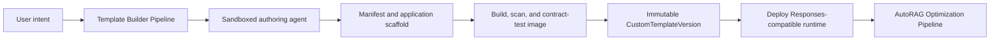
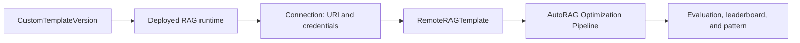

# Open Data Hub - AutoRAG Custom RAG Template Builder

|                |            |
| -------------- | ---------- |
| Date           | 2026-10-16 |
| Scope          | AutoRAG Component |
| Status         | Proposed |
| Authors        | Lukasz Cmielowski |
| Supersedes     | N/A |
| Superseded by: | N/A |
| Tickets        | N/A |
| Other docs:    | [ODH-ADR-0007](./ODH-ADR-0007-custom-rag-templates.md) |

## What

Provide a separate Template Builder KFP pipeline that turns a user request into a deployable Custom RAG Template image. The pipeline can use a sandboxed authoring agent to generate a manifest and application scaffold, build and validate an immutable image, and produce deployment assets for a Responses-compatible RAG runtime.

AutoRAG optimization consumes the deployed runtime through the remote Custom RAG Template contract in [ODH-ADR-0007](./ODH-ADR-0007-custom-rag-templates.md). The builder does not add arbitrary user code to the optimization pipeline.

## Why

Users may need proprietary retrieval, reranking, agent flows, prompts, or integrations that the built-in templates cannot express. They need a supported path from a natural-language description to a deployable RAG application without making AutoRAG orchestration own mutable user dependencies.

Building and deploying the runtime separately keeps optimization reproducible: the optimization pipeline calls a stable, versioned endpoint rather than generating or executing draft code.

## Goals

* Create a guided path from natural-language intent to a versioned Custom RAG Template image.
* Build, scan, test, and publish an immutable image and deployment assets.
* Produce a Responses-compatible runtime consumable by the remote-template integration.
* Preserve common AutoRAG evaluation, `pattern.json`, and MLflow contracts through that integration.
* Keep Connections and credentials outside generated source, image layers, and template metadata.

## Non-goals

* A fully no-code editor for arbitrary RAG or agent graphs.
* Installing generated user packages into the AutoRAG optimization image.
* Defining a custom indexing protocol; the deployed runtime uses a compatible managed index, a user-managed index, or a separately documented integration.
* Replacing the remote Responses-endpoint integration in [ODH-ADR-0007](./ODH-ADR-0007-custom-rag-templates.md).

## How

## Template Builder Pipeline

Template authoring and optimization are separate KFP pipelines. The builder accepts a natural-language intent, an optional starter template, implementation constraints, and safe test inputs. A sandboxed authoring agent may generate the initial manifest and application scaffold, but it never publishes or replaces a template without validation and user approval.



The builder pipeline emits an immutable versioned artifact:

```text
CustomTemplateVersion
├── template_id and version
├── manifest digest
├── container image digest
├── deployment asset reference and digest
├── supported capabilities and parameter schema
├── image scan and contract-test result
└── provenance: authoring request, generator version, and creation time
```

The builder does not persist Secrets in this artifact. It records required Connection types and names only.

## Builder experience

The builder is a guided authoring flow, not a general-purpose visual programming environment.

| Step | User action | Output |
| --- | --- | --- |
| Overview | Name the template, select a base profile, and describe its purpose. | Template identity and version. |
| Implementation | Provide a description, starter template, and approved dependencies. | Generated application scaffold. |
| Parameters | Declare fixed, runtime-supplied, and optimizable settings. | Typed parameter schema. |
| Test | Run a sample question against a sandboxed runtime. | Contract-validation result and sample response. |
| Publish | Freeze a validated version after explicit user approval. | Image and deployment assets for an immutable `CustomTemplateVersion`. |

The initial experience should support cloning a built-in template or starting from a code scaffold. A visual composition canvas can be considered later, once the manifest and runtime contracts are stable.

## Template and runtime contract

Each published template contains a manifest, a container image, and deployment assets. The manifest is the stable contract consumed by the Dashboard and the deployment flow; the image implements the user-owned RAG behavior.

```text
CustomRAGTemplate
├── identity: template_id, version, display name, description
├── runtime: image digest and Responses-compatible endpoint contract
├── deployment: deployable runtime asset
├── capabilities: supported store profiles and optional retrieval or agent features
├── parameters
│   ├── fixed: template-defined behavior
│   ├── runtime: corpus and non-secret run inputs
│   └── optimizable: typed ranges or choices AutoRAG may explore
├── connections: required Connection types and reference names
└── response_contract: answer, retrieved contexts, usage, and error fields
```

The manifest must identify every optimizable parameter, including its type, permitted range or values, default, and user-facing label. It must not contain secret values, a Kubernetes Secret payload, or an unrestricted arbitrary-code parameter.

| Setting class | Owner | Examples |
| --- | --- | --- |
| Fixed | Template author | Agent topology, mandatory safety behavior, a fixed prompt policy. |
| Runtime | Run submitter | Corpus reference, benchmark dataset, Connection reference. |
| Optimizable | AutoRAG | Candidate count, reranker choice, generation temperature. |
| Secret | RHOAI Connection | MaaS or database credentials; never copied into the manifest, image, or pattern settings. |

## Deployment and optimization integration

The published image can be deployed as a Responses-compatible RAG service. Deployment resolves the runtime's MaaS, database, and other required Connections through Secret references; it never writes credentials into the image or the `CustomTemplateVersion`.

After deployment, the user creates or selects a Connection to the service endpoint. AutoRAG optimization receives that Connection through the `custom_rag_secret_name` input defined in [ODH-ADR-0007](./ODH-ADR-0007-custom-rag-templates.md).



The optimization pipeline sends benchmark questions and candidate non-secret settings to the deployed endpoint. The endpoint returns generated answers and retrievable contexts; AutoRAG evaluates and ranks them using the standard contracts. The image digest and template version are recorded as provenance for the resulting RAG pattern.

## Validation and publication

Before publication, the builder validates the manifest and parameter schema, builds the image from approved inputs, scans it, and runs a sandboxed Responses-contract test. The test verifies that the runtime accepts an allowed request and returns normalized answer and context information.

Publication creates an immutable template version. A changed implementation, image, or deployment asset requires a new version. Existing deployments, optimization runs, and patterns retain the exact image digest and template version they used.

## Security and isolation

* The authoring agent has no user Secrets, cluster-admin access, or unrestricted network access; it uses only approved images, package sources, and component interfaces.
* Deployment injects Connections through Secret references. Secret material is never embedded in source artifacts, image layers, manifests, optimization settings, artifacts, or MLflow parameters.
* The submitting principal must be authorized to use every named Connection before a sandbox test, deployment, or optimization run is started.
* The platform applies its image, resource, network, and service-account policies to build, test, and deployed runtime workloads.
* Runtime output is validated by the remote-template integration before it is passed to evaluators or persisted as an AutoRAG artifact.

## Integration with existing contracts

The remote-template integration creates RAG patterns using the shared pattern-artifact envelope. The pattern records the immutable template identity, version, and image digest, as well as selected settings, indexing reference when applicable, and evaluation results.

MLflow uses the existing parent AutoRAG run and nested per-pattern runs. It records template identity, version, image digest, non-secret settings, metrics, and pointers to KFP artifacts; it does not log credentials or raw sensitive payloads.

## Alternatives

### Remote Responses endpoint without a builder

Users can deploy an existing RAG service and optimize it directly through [ODH-ADR-0007](./ODH-ADR-0007-custom-rag-templates.md). This remains appropriate for an existing service. The builder adds a supported authoring and deployment path when no such service exists.

### Custom child KFP run per optimization candidate

Running custom implementation code inside a KFP child run would support arbitrary dependencies, but it couples optimization to image construction and user code execution. It is not selected; optimization calls a separately deployed, immutable runtime through the remote-template contract.

### Authoring inside an optimization run

Generating a template during optimization would make the executable code mutable and make run reproduction difficult. It is not selected; optimization consumes a deployed runtime with immutable image provenance.

### Fully visual graph builder

A visual graph can improve discoverability for common flows, but it cannot safely represent arbitrary proprietary code, dependencies, or agent behavior. It is deferred until the manifest and runtime contracts are proven.

## Related

* [Custom RAG remote Responses endpoint](./ODH-ADR-0007-custom-rag-templates.md)
