# Open Data Hub - AutoRAG Code RAG MVP

|                |            |
| -------------- | ---------- |
| Date           | 2026-10-21 |
| Scope          | AutoRAG Component |
| Status         | Approved |
| Authors        | Lukasz Cmielowski |
| Supersedes     | N/A |
| Superseded by: | N/A |
| Tickets        | N/A |
| Other docs:    | [ODH-ADR-0001](./ODH-ADR-0001-autorag.md) · [ODH-ADR-0002](./ODH-ADR-0002-experiment-settings.md) · [ODH-ADR-0003](./ODH-ADR-0003-rag-templates.md) · [ODH-ADR-0004](./ODH-ADR-0004-rag-pattern-inference.md) · [ODH-ADR-0005](./ODH-ADR-0005-rag-pattern-evaluation.md) |

## What

Add repository question-answering to AutoRAG by extending its existing document artifacts and chunking path. Source files are read directly into language-tagged `CodeItem` objects inside `DoclingDocument`; documents and READMEs continue through existing Docling conversion. Both paths produce `AI4RAGChunk` objects for the existing optimization, indexing, retrieval, and generation engine.

The MVP accepts source snapshots through the existing S3-compatible Connections and supports multilingual corpora, including legacy languages, through bounded text windows. Docling's Tree-sitter-backed code chunking is an additional capability for validated languages. Vector / hybrid retrieval on Milvus / PGVector is the baseline; the existing Neo4j Graph RAG path is an optional, separately validated profile. Code-only and mixed code / documentation corpora are supported. This ADR describes required work, not capabilities already available in the document pipelines.

## Why

AutoRAG already accepts `DoclingDocument` artifacts, produces framework-neutral `AI4RAGChunk` objects, and reuses indexes across candidates with identical indexing settings. Replacing this input contract or adopting a separate Code RAG application would add integration and maintenance work before establishing a quality benefit.

Docling already includes a Tree-sitter-backed [code chunking strategy](https://github.com/docling-project/docling-core/blob/main/docling_core/transforms/chunker/code_chunking/standard_code_chunking_strategy.py). Reuse that implementation behind an explicit AutoRAG adapter. Keeping the document representation does not require running source files through document conversion, nor does the existing AutoRAG `DoclingChunker` automatically enable code-aware chunking.

Language ingestion must not depend on structural parser availability. Legacy repositories can contain COBOL, copybooks, Fortran, C / C++, Java, SQL, and job-control files. These are target corpus examples, not a promise of complete dialect or semantic support. A common text path provides useful retrieval before a dedicated parser is available. Publish language capabilities separately for ingestion, structural chunking, and graph extraction quality.

Research supports evaluating structural chunking but does not establish whole functions as a universal default. [cAST](https://aclanthology.org/2025.findings-emnlp.430/) reports benefits from structural splitting and merging; a later [controlled study](https://arxiv.org/html/2605.04763v1) finds sliding windows competitive with cAST and function chunking weaker on its completion benchmarks. Those results motivate a comparison in AutoRAG; they do not establish a winner for repository Q&A.

## Goals

* Answer identifier lookup, behavior explanation, and bounded cross-file questions about an immutable repository snapshot, including legacy source and related files.
* Balance retrieval quality with a small extension of existing AutoRAG components and dependencies.
* Preserve exact source evidence and verifiable file / line citations.
* Reuse HPO, MaaS, Connections, vector stores, pattern artifacts, evaluators, and optional MLflow tracking.
* Keep chunking selection consistent across optimization and production indexing.
* Retain S3 as the pipeline's source contract, independently of whether files originate in Git or a legacy source export.

## Non-Goals

* Code completion, patch generation, repository execution, or automated software repair.
* Verified call / dependency graphs, a new structural code graph schema, compiler / LSP integration, or MCP tools.
* A new generic corpus framework, arbitrary chunker plugins, or a separate Code RAG service.
* Git-provider connectors, archive ingestion, incremental synchronization, or mutable branch tracking.
* Complete language / dialect semantics or a structural parser for every ingested language.
* New rerankers, dependency expansion, or a new optimization algorithm.

## How

### Ingest through existing artifacts

```mermaid
flowchart LR
    Export[CI checkout or legacy source export] --> Publish[Publish files and manifest to S3]
    Publish --> Snapshot[Validate S3 snapshot]
    Snapshot --> Route{File type}
    Route -->|Configured source files| Code[Direct read into Docling CodeItem]
    Route -->|Documents and READMEs| Docs[Existing Docling conversion]
    Code --> Artifact[DoclingDocument artifacts and snapshot manifest]
    Docs --> Artifact
    Artifact --> Chunker[Shared chunker factory]
    Chunker --> Chunks[AI4RAGChunk with source metadata]
    Chunks --> Engine[Existing indexing and optimization engine]
    Engine --> Pattern[Pattern and evaluation]
    Pattern --> Index[Full-snapshot indexing using same factory]
    Index --> Store[(Selected vector or graph store)]
    Store --> Infer[Existing RAG runtime with source citations]
```



### S3 input and snapshot publication

The user supplies a materialized repository snapshot as individual objects in S3-compatible storage. Reuse the current Connection and input contract from [ODH-ADR-0002](./ODH-ADR-0002-experiment-settings.md), with one new code-profile input:

| Input | Code RAG role |
| ----- | ------------- |
| `input_data_secret_name` | Existing S3 Connection; optimization and indexing need read access to the snapshot. |
| `input_data_bucket_name` | Existing bucket containing the source snapshot. |
| `input_data_keys` | Existing list of corpus keys / prefixes, normally one `files/` prefix. Retain the existing maximum of ten locations in one bucket / Connection. |
| `input_data_manifest_key` | New input, required for code-profile runs: object key of the snapshot manifest in the same input bucket, read through the same Connection. Optional / unused for existing document-only runs. |
| `test_data_secret_name`, `test_data_bucket_name`, `test_data_key` | Existing benchmark inputs. Benchmark access may use its existing separate Connection. |

Example object layout:

```text
s3://rag-corpora/payments/<snapshot-id>/
├── files/
│   ├── src/PAYMENT.cbl
│   ├── copybooks/ACCOUNT.cpy
│   └── docs/processing.md
├── manifest.json
└── benchmark.json
```

Here `input_data_keys` selects `payments/<snapshot-id>/files/`, while `input_data_manifest_key` selects `payments/<snapshot-id>/manifest.json`. The benchmark uses its own input key and is not part of the corpus. A benchmark evidence key is the full object key, for example `payments/<snapshot-id>/files/src/PAYMENT.cbl`.

The manifest is the authoritative file list. It records a schema version, source identity, immutable revision when available, exact file keys / relative paths, byte sizes and content hashes, encoding / source-format mappings, and exclusion policy. Source identity need not be a Git URL: legacy exports use an export identity. The manifest digest identifies that publication. A revision label or commit-named prefix alone does not establish immutable content.

Preparation reuses an existing CI checkout or source export when possible, filters the desired files, and uploads them to a new snapshot prefix. Publish the manifest last, only after every listed object is uploaded. Never update an already published snapshot in place; changed content creates a new snapshot. Submodules, include libraries, or other required external files must be explicitly materialized and identified by preparation, rather than fetched implicitly by AutoRAG.

The pipeline validates the manifest schema, requires its file keys to fall within the selected corpus locations, and verifies listed objects and hashes while materializing them. Missing or changed objects fail the run. Unlisted objects are not ingested; publishing an additional object cannot silently change the corpus. Record the manifest digest with the run and pattern, and require the same digest and file hashes during production indexing. Download and prepare the corpus once per pipeline run, with reusable extraction artifacts across HPO candidates. Full-corpus indexing is a separate run against the same pinned publication.

Individual objects fit today's discovery and extraction path. Many tiny files can create request overhead; measure that cost before adding an archive input. Archive ingestion would require a new extraction and validation component and is outside this MVP. S3 bucket versioning is optional and does not replace manifest / content validation.

### Git acquisition as a later preparation component

The MVP does not need a Git Connection, clone inside optimization, or repository history. A later reusable **Prepare Repository Snapshot** component can accept a repository URL and ref, a Git credential Connection, included paths / exclusions, and a destination S3 Connection / prefix. It resolves the ref once to an immutable commit, acquires the required files, publishes the same snapshot format, and returns the S3 inputs and manifest digest. Acquisition may reuse a checkout or use a commit-specific archive when supported; cloning is an implementation choice of preparation.

Git credentials and destination write access belong to preparation. Optimization and indexing retain S3 read access and do not need Git credentials or Git-server connectivity. Changing a branch creates a new publication; it never changes the corpus during a run. This extension adds repository-selection convenience without introducing a second ingestion contract or repeated cloning in the HPO loop.

### Source representation

Discovery accepts a configured allow-list of source / related text extensions and explicit path mappings alongside existing supported document types. Initial profiles cover common source and legacy assets, including COBOL / copybooks, Fortran, C / C++, Java, JavaScript / TypeScript, Python, SQL, and JCL. Extensionless or ambiguous files need an explicit mapping; discovery must not ingest every file as text. The source adapter preserves decoded source and language using `DoclingDocument.add_code()`, with one source file per document, and bypasses `DocumentConverter`. If Docling has no matching language label, preserve the declared language / dialect in the manifest and use its generic code representation with text windows. An empty supported corpus fails validation.

Record source encoding and source format where relevant. UTF-8 is the default; a manifest can declare a supported alternative encoding, including a specific EBCDIC code page. Decode strictly, retain the original-byte hash and decoded-text hash, and report decoding failures without silently replacing characters. Preserve indentation, columns, continuation lines, and source line identities. Fixed-format source, copybooks, includes, SQL, and job-control files are indexed as separate evidence; the MVP does not expand includes, run preprocessors, or resolve dynamic calls. The same files, identities, and policies are used in optimization and full-corpus indexing.

`DoclingDocument.name` remains the full corpus object key. This flows into chunk metadata as `document_id` and into evaluation artifacts as `document_key`, preserving the existing benchmark contract. A companion manifest supplies snapshot and path metadata without requiring a replacement experiment-input representation.

### One chunker factory, two code strategies

Use one allow-listed, serializable chunker factory from both the experiment engine and the managed indexing component. Existing document strategies retain their behavior. The code profile offers only:

| Strategy | MVP behavior |
| -------- | ------------ |
| Structural when available | Explicit adapter to Docling's `StandardCodeChunkingStrategy`, using only validated languages / dialects in the pinned image and a configured size limit. Map code metadata into `AI4RAGChunk`. Other languages retain text windows in the same run. |
| Text window | Deterministic, line-preserving windows bounded by the configured token budget, with a fixed overlap policy. Available for every enabled text-ingestion profile, regardless of parser coverage, and used for reported structural parse failures. |

Structural chunking is a candidate, not an assumed quality winner. The adapter must explicitly configure the code strategy; wrapping a source file in `CodeItem` and invoking the current hybrid chunker is insufficient. Reuse public Docling interfaces and avoid imports of private language chunkers.

Docling's current strategy covers Python, JavaScript, TypeScript, Java, and C; that does not establish support for C++, COBOL, Fortran, or every dialect. Additional Tree-sitter grammars exist for [COBOL](https://github.com/yutaro-sakamoto/tree-sitter-cobol) and [Fortran](https://github.com/stadelmanma/tree-sitter-fortran), but a grammar alone does not provide an AutoRAG chunker or verified semantic relationships. The MVP does not require those integrations. A versioned capability table records the effective text / structural behavior for each language, source format, and dialect. In a corpus with no structural capability, omit the duplicate structural candidate from HPO.

Size limits include any added context. Use a suitable tokenizer when available; any estimate needs conservative limits and embedding-endpoint validation. Preserve the original source separately from enriched search text. Normalize and verify source ranges against that original, including line-number conventions and imports or signatures copied into a chunk. A chunk containing several source spans must not claim that its enriched text is one contiguous original passage.

Missing structural support and structural failures use the fixed text-window path and are counted separately in the coverage report. There is no configurable fallback-policy matrix in the MVP. Binary / undecodable source is excluded with a reason. Text-only support does not claim symbol extraction or dependency resolution.

### Retrieval and context assembly

Reuse existing vector and hybrid retrieval on the selected Milvus or PGVector backend. Hybrid retrieval is the preferred candidate for code, with vector-only retrieval retained as a comparison. Validate lexical behavior for exact names, `snake_case`, `camelCase`, qualified names, and paths on each enabled backend. The existing PGVector adapter uses English full-text analysis, so current hybrid support alone is insufficient evidence of identifier retrieval quality. Make any necessary analyzer change an explicit code-index profile, recorded with the index settings.

Include legacy identifiers and formats in these checks, for example hyphenated COBOL names, copybook names, qualified Java names, and SQL objects. Preserve the original identifier while optionally indexing normalized forms. Validate embedding and generation models on the target languages; successful decoding or parsing does not establish retrieval or answer quality.

Use existing registered retrieval / generation compositions. Code ingestion does not introduce a new `template_id`; identifiers remain governed by [ODH-ADR-0003](./ODH-ADR-0003-rag-templates.md). Enable a runtime only after it supports the code profile and metadata contract.

Apply a fixed total context-token budget, deduplicate results, and pack complete source spans deterministically. Return fewer chunks when necessary to fit that budget. Disable the current document-oriented LLM excerpt compressor for code-profile runs, including mixed corpora, so that it cannot silently remove surrounding code. Additional context expansion and code-specific compression are deferred.

Each returned code context retains snapshot identity, file key, relative path, source line spans, language, and symbol name / kind when available. Carry this metadata through prompt rendering, inference responses, and evaluation exports. Citations use validated source spans; copied or generated context does not acquire a false source location.

### Reuse existing Graph RAG as an optional profile

AutoRAG already has a Neo4j path that stores canonical chunks, extracts entities / relationships with an LLM, and expands retrieval through links back to source chunks. Reusing that path can help test questions spanning code, documentation, business concepts, and data objects without building a new code graph engine. It still requires validation of the code profile, metadata preservation, extraction behavior, and retrieval quality.

This is a knowledge graph inferred from source text, not a compiler-derived call or dependency graph. The answer may use graph links to find evidence, but claims about callers, data flow, or impact must be supported by retrieved source. Unresolved or dynamically selected targets must not become verified edges merely because an LLM inferred a relationship. A request for exhaustive impact analysis is outside the MVP's guarantees.

The user selects the vector or existing graph store profile before optimization; HPO does not provision databases or switch store architectures. Neo4j is an alternative store binding, not an additional database required alongside Milvus / PGVector. Keep its extraction schema / prompt policy and graph expansion settings bounded, and record their effective versions / values. Include extraction model and configuration in index identity because changing them changes the graph.

Enable this optional profile only after it passes the same source-citation checks and is compared with the vector / hybrid baseline on representative cross-file questions. Report graph extraction cost, indexing time, and query latency as well as answer quality. Baseline multilingual Code RAG must remain usable without Neo4j or structural parser coverage. A deterministic structural graph can be considered separately if measured use cases require it.

### Optimization, indexing, and artifacts

Keep the existing HPO algorithm, pattern budget, model choices, and evaluator-qualified objective. Bound the additional search to the two code strategies where applicable, a small size allow-list, existing top-k values, and retrieval settings supported by the selected store profile. Overlap, context budget, fallback, and exclusion policy are fixed run settings. Document chunking follows the selected existing document preset.

Separate index-changing settings from query-time settings. Reuse an index only when snapshot identity, source decoding / format settings, language capability table, chunking profile / settings, parser and grammar versions, lexical analysis, and embedding configuration match. Graph extraction configuration and model also participate for the graph profile. Query-time top-k or answer-generation changes do not rebuild it.

Use the existing [pattern envelope](./ODH-ADR-0004-rag-pattern-inference.md). Persist the code-profile version, manifest reference and digest, language / dialect / encoding / source-format mappings, effective capability table, document and code chunking settings, lexical profile, fixed context budget, and runtime / component versions. Copy the S3 bucket, corpus locations, `input_data_manifest_key`, and Connection reference into the indexing specification, retaining the expected manifest digest for validation. For graph patterns, also persist effective knowledge-graph extraction and retrieval settings through the existing graph contract. A shared factory reconstructs that configuration in full-corpus indexing. Unsupported profiles fail validation rather than silently falling back to document indexing. Existing document-only patterns remain readable.

Extend the managed components and generated indexing / inference assets to consume this profile. The experiment, model pre-selection, and indexing paths continue to exchange Docling documents. Dashboard validates the supported profile; MLflow records non-secret settings, versions, coverage, and artifact references through its existing run hierarchy.

### Sampling and evaluation

Use the complete filtered snapshot for MVP optimization when it fits the existing optimization resource limits. If it does not fit, require a user-selected, immutable package snapshot that fits; do not silently apply the current benchmark-prioritized file sampling to code-profile runs. Benchmark annotations select evidence for scoring, not which files become retrieval distractors. A package sample must contain the context needed to answer its benchmark questions.

Evaluate the winning settings against the intended full snapshot before treating sample results as representative of production. Missing dependencies and additional distractors can change results even when the extraction configuration is identical.

Reuse existing answer correctness / groundedness metrics and exactly one supported optimization objective from [ODH-ADR-0005](./ODH-ADR-0005-rag-pattern-evaluation.md). Code benchmarks add expected identifier, symbol, or source-span annotations for deterministic retrieval and citation diagnostics; these diagnostics are not new GAM objectives in the MVP. Compare strategies on the same snapshot, models, and context budget, with separate tuning and held-out questions. Report quality by language / dialect and text versus structural capability; a Python aggregate cannot establish legacy-language quality.

MVP acceptance requires:

* Reuse of the existing S3 Connection for corpus and manifest access, rejection of incomplete / changed snapshots, exclusion of unlisted objects, and preservation of the expected manifest digest in production indexing. A document-only run does not require the new manifest input.
* End-to-end ingestion, optimization, pattern reconstruction, indexing, and inference for multilingual and mixed code / documentation corpora. Include a COBOL / copybook text-window case and a language with enabled structural chunking, such as C or Java.
* Correct handling of a declared non-UTF-8 encoding, fixed-format columns / continuation lines, and included files indexed separately, with decoding and parsing failures reported.
* Matching chunk identity and source metadata when optimization and indexing use the same inputs and settings.
* Correct retrieval of representative identifiers and paths on each enabled backend and ingestion profile. Each advertised language / dialect profile has fixtures that verify decoding, text preservation, and source citations; structural capability requires separate parser / extraction checks.
* Verified source citations, including fallback chunks, with metadata retained in evaluation artifacts.
* Reported answer quality, symbol / span retrieval quality, fallback coverage, latency, and index size against the text-window baseline. Structural chunking becomes the default only if measured quality and cost justify it.
* For the optional graph profile, source-grounded cross-file answers and a quality / cost comparison against the baseline, without presenting inferred graph relationships as verified program semantics.

## Alternatives

| Alternative | Decision |
| ----------- | -------- |
| S3 files with a snapshot manifest | Selected input contract. Reuses existing Connections and pipeline storage access for both Git exports and legacy source exports. |
| Clone directly in optimization | Deferred in favor of a separate Git-to-S3 preparation component. Adds credentials and network dependencies to the optimization path without improving the corpus contract. |
| Packaged source archive in S3 | Deferred until file-count overhead warrants it. Requires archive materialization and validation support beyond current per-object discovery. |
| Reuse Docling code strategy and existing artifacts | Selected. Smallest integration boundary that preserves structural chunking and AutoRAG's indexing-time optimization. |
| Independently maintain Tree-sitter queries and a new source representation | Deferred. Adds grammar / extraction ownership and changes experiment inputs. Revisit for demonstrated language or quality gaps. |
| Text windows only | Retained as baseline and fallback. Lowest complexity, but structural chunking may improve the target workload. |
| cAST / ASTChunk | Deferred additional strategy. Benchmark it if the two MVP strategies leave a measured quality gap. |
| Adopt CodeRAG / Code-Graph-RAG | Deferred. Their broader runtime and storage responsibilities exceed the MVP's needs. |
| Remote code service with a prebuilt index | Possible through the proposed [remote-template integration](./ODH-ADR-0007-custom-rag-templates.md), once implemented. Useful for existing customer services, but cannot optimize index-time settings on a fixed index. |
| Existing Neo4j knowledge-graph retrieval | Optional profile using current Graph RAG components after code-specific validation. Useful for testing conceptual / cross-file retrieval; does not provide verified call graphs. |
| New structural graph, compiler, or LSP enrichment | Deferred until benchmark failures demonstrate a need for semantic resolution beyond existing retrieval. |

## Security and Privacy Considerations

* Treat code, comments, and repository documentation as untrusted evidence. Ingestion never executes source, hooks, build scripts, or dependency installation.
* Use existing authorized RHOAI Connections and namespace / project access controls. Keep credentials out of source artifacts, manifests, patterns, logs, and MLflow parameters.
* Source acquisition uses separate Git / S3-write credentials when provided outside the MVP. AutoRAG only reads the published S3 snapshot. Manifest paths cannot escape the selected corpus locations; hashes and the pinned manifest digest are verified before using source artifacts.
* Apply explicit path exclusions before indexing; exclude repository internals, credential files, binaries, and generated / vendored content by default. Exclusions reduce exposure but do not guarantee that arbitrary source contains no secrets.
* Bound source file size and parser resources, reject paths or symlinks escaping the materialized snapshot, and pin grammar dependencies in the approved runtime image.
* An MVP corpus must share one authorized audience. Separate indexes are required for different repository access policies; per-file authorization is outside this MVP.
* Source, embeddings, retrieved contexts, and artifacts inherit corpus confidentiality and retention requirements. Private code uses approved MaaS endpoints and is excluded from telemetry by default.

## Risks

* Upstream code chunking availability does not guarantee parser packaging, exact provenance, or retrieval quality. Validate the pinned image and source mapping before enabling the profile.
* Structural chunks may include copied context, and fallback can change boundaries. Preserve source spans and report coverage instead of silently assuming function-level precision.
* Shared factories, code-aware metadata exports, context budgeting, and artifact reconstruction require coordinated engine and pipeline changes. Merely adding source extensions to discovery is insufficient.
* Full-snapshot optimization limits MVP corpus size. Larger corpora require an explicit representative package sample and full-corpus validation.
* Per-file S3 requests can dominate preparation for large file counts. Measure acquisition / download costs independently of retrieval quality before introducing a packaged snapshot format.
* Legacy dialects, encodings, source formats, and embedded languages vary. Report the effective ingestion / structural capability and evaluate representative target repositories rather than claiming blanket language support.
* LLM-extracted graph relationships can be incomplete or wrong. Keep source evidence authoritative, and validate graph retrieval separately from structural parsing.

## References

* [AutoRAG architecture](./ODH-ADR-0001-autorag.md)
* [Optimization settings](./ODH-ADR-0002-experiment-settings.md)
* [RAG templates](./ODH-ADR-0003-rag-templates.md)
* [Pattern inference and indexing](./ODH-ADR-0004-rag-pattern-inference.md)
* [Pattern evaluation](./ODH-ADR-0005-rag-pattern-evaluation.md)
* [Docling code chunking strategy](https://github.com/docling-project/docling-core/blob/main/docling_core/transforms/chunker/code_chunking/standard_code_chunking_strategy.py)
* [Docling code metadata](https://github.com/docling-project/docling-core/blob/main/docling_core/transforms/chunker/code_chunking/code_chunk.py)
* [cAST paper](https://aclanthology.org/2025.findings-emnlp.430/)
* [Controlled study of code chunking](https://arxiv.org/html/2605.04763v1)
* [COBOL Tree-sitter grammar](https://github.com/yutaro-sakamoto/tree-sitter-cobol) — candidate for later structural support, not an MVP dependency.
* [Fortran Tree-sitter grammar](https://github.com/stadelmanma/tree-sitter-fortran) — candidate for later structural support, not an MVP dependency.
