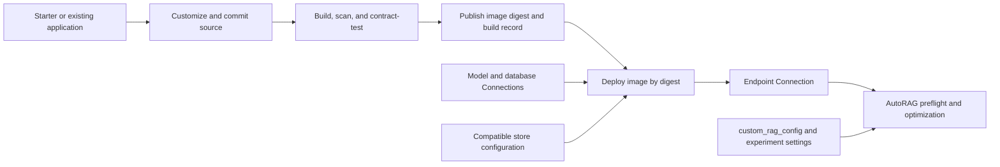

# Open Data Hub - AutoRAG Custom RAG Template Builder

|                |            |
| -------------- | ---------- |
| Date           | 2026-10-16 |
| Scope          | AutoRAG Component |
| Status         | Proposed |
| Authors        | Lukasz Cmielowski |
| Supersedes     | N/A |
| Superseded by: | N/A |
| Tickets        | N/A |
| Other docs:    | [ODH-ADR-0007](./ODH-ADR-0007-custom-rag-templates.md) |

## What

Provide a supported application scaffold and a standard source-to-image build workflow for custom RAG services. Authors customize the RAG implementation in source control; the build pipeline builds, scans, contract-tests, and publishes an image conforming to `responses.file_search.v1`.

Deployment and AutoRAG optimization are separate steps. Model and database Connections are supplied at deployment; benchmark, search-space, objective, and budget settings are supplied to AutoRAG afterward.

[ODH-ADR-0007](./ODH-ADR-0007-custom-rag-templates.md) is authoritative for the remote optimization contract. This workflow does not introduce custom optimization schemas, request mappings, or response formats.

## Why

Users may need proprietary retrieval, reranking, agent flows, or integrations that the built-in templates cannot express. A starter application lets them implement that behavior while reusing the standard HTTP contract and tests.

An ordinary repository and image build avoids a new manifest-driven authoring system. Customers can use the supported build pipeline or an existing CI pipeline that performs the same validation. AutoRAG optimization invokes the deployed endpoint and keeps customer dependencies outside its own image.

## Goals

* Provide a starter with the standard endpoint, implementation interfaces, and contract tests.
* Build and publish a validated image from source pinned to a commit.
* Separate build inputs, deployment configuration, and optimization settings.
* Preserve ADR-0007's request profile, index modes, evaluation, artifacts, and MLflow integration.
* Record source and image provenance without embedding credentials.

## Non-goals (v1)

* A natural-language authoring agent, custom template manifest, or visual graph editor.
* Installing customer packages or executing draft code inside AutoRAG optimization.
* Defining custom optimization parameters, response envelopes, or indexing protocols.
* Automatically deploying or replacing a running endpoint as part of an image build.

## How

### Starter application

The supported starter contains:

* `/v1/responses`, request validation, and native Responses output for `responses.file_search.v1`.
* Interfaces for retrieval, optional reranking, and generation. Authors implement custom behavior behind these interfaces; the starter handles the HTTP contract.
* Handling for supported standard request controls, explicit rejection of unsupported parameters and values, and file-search result serialization.
* Health checks, a container build definition, pinned dependencies, and example deployment assets using Connection references.
* Contract tests and safe fixtures that run without live model or database credentials.

The implementation must honor every control advertised as supported. Proprietary reranker selection, agent topology, and other implementation-specific settings are configured in source or at deployment and remain fixed during an experiment. AutoRAG varies only the fields allowed by ADR-0007.

### User workflow

1. Copy the starter into a repository and customize the RAG implementation, dependencies, and tests.
2. Submit a source commit and image destination to the build pipeline, or run equivalent validation in existing CI.
3. Review the published image digest, build provenance, and validation results.
4. Deploy the image by digest with the required model/database Connections and compatible store configuration.
5. Create a Connection to the deployed endpoint, configure the experiment in AutoRAG, and pass ADR-0007's preflight before optimization.

A user with an existing RAG application can add the same endpoint contract and tests to that application and keep its existing build process. Copying the starter is optional.



### Build pipeline inputs

The build uses the repository's container build definition, dependency files, tests, and example deployment assets. A dedicated KFP authoring pipeline is not required; the build can run in KFP or existing CI.

| Input | Required | Purpose |
| --- | --- | --- |
| Source repository and full commit SHA | Yes | Identify the exact application source, dependencies, and tests to build. Branch names and moving tags must resolve to a commit before the build starts. |
| Image destination | Yes, unless platform-provided | Approved registry repository for the validated image. |
| Registry Connection reference | When required | Authorize the publication step. |
| Source Connection reference | For private repositories | Authorize source checkout. |

Template identity can default to the repository name; version is an immutable build identifier linked to the source commit. Neither requires a custom manifest or a separate authoring form.

Natural-language requirements, model/database Connections, live index IDs, benchmark datasets, and optimization candidate lists are not build inputs. Authors express implementation requirements in source and include safe test fixtures in the repository.

### Build outputs

The pipeline emits standard build artifacts rather than introducing a new template resource or parameter schema:

```text
Build record
├── template identity and immutable build version
├── source repository and commit SHA
├── published container image reference and digest
├── compatibility profile: responses.file_search.v1
├── image scan and contract-test results
├── example deployment asset references and digests
└── build toolchain version and creation time
```

Build records contain no credentials. The image digest is the deployment reference; changing source, dependencies, or build inputs requires a new build record and version. Publication does not deploy or replace an endpoint. Pinned inputs and recorded provenance support reproducibility but do not guarantee that a remote endpoint or index remains unchanged.

### Validation and publication

The pipeline builds from approved inputs, scans the image, and runs the application tests and sandboxed profile contract tests before publishing. Contract tests use safe fixtures and the shared profile-aware client and result normalization from ADR-0007. They cover:

* Exactly one `file_search` tool and the required fixed controls: `stream: false`, `store: false`, forced file search, and `include: ["file_search_call.results"]`.
* HTTP 200 with `object: "response"`, `status: "completed"`, completed `file_search_call` output, and an unambiguous final assistant message containing `output_text`.
* Included search-result text and file identities that resolve to canonical document keys in the test fixtures. Citations alone are insufficient. A completed search with `results: []` is valid.
* Documented semantics for required and advertised optional controls, including clear validation errors for unsupported parameters, values, and model-specific combinations. Application tests verify control handling; a successful HTTP response alone does not prove that a control affects behavior.
* Failure handling for missing or invalid search results, missing search calls, ambiguous answers, unsuccessful responses, and unfinished function calls.
* Preservation of search-call identity, queries, result order, scores, repeated passages, and multi-step structure, with `context_source: "retrieval_results"`. Retrieval scores are not evaluator metrics, and unavailable usage is not recorded as zero.

Fixture tests establish application behavior without production credentials. Before GAM starts, the deployed endpoint must also pass ADR-0007's preflight using the final request configuration, a representative benchmark question, the actual index binding, and resolvable document identities. Failed benchmark responses remain visible and candidates with incomplete evaluation are excluded from normal ranking.

### Deployment and optimization inputs

| Stage | User supplies |
| --- | --- |
| Deployment | Image digest, model and database Connection references, model IDs where needed, resource settings, compatible store configuration, and fixed implementation-specific settings. |
| Optimization | Endpoint Connection through `custom_rag_secret_name`; `custom_rag_config` with standard request defaults, finite candidate lists, and optional `document_keys`; index mode and its required inputs; benchmark, objective, budget, and evaluator settings. |

Deployment injects runtime credentials through authorized Secret references. Build and test jobs do not require live model/database Connections. The deployed service completes retrieval, generation, and any internal tool execution within the Responses call; AutoRAG does not execute returned function calls.

The user selects ADR-0007's pre-built index mode or managed built-in indexing pipeline with a fixed compatible recipe. Deployment integration maps the prepared store to `request.tools[0].vector_store_ids` before optimization. That binding, optional access filters, and index contents remain fixed across candidates. Built-in full-corpus promotion may explicitly update the recorded binding as described in ADR-0007.

The optimization wizard constructs and validates `custom_rag_config` using AutoRAG-owned field definitions. It does not discover parameters from source or generate forms from a customer manifest. Endpoint URLs and credentials remain in the endpoint Connection.

### Artifacts and MLflow

Patterns retain ADR-0007's remote discriminator: `template_id: "custom:remote_responses"` and `inference.kind: "remote_responses"`. `settings.request` records the effective winning request except per-question `input`, including the authoritative `vector_store_ids`. `inference.remote_spec` retains the profile, Connection reference, and document-id mapping. `indexing` records the selected index mode and managed recipe where applicable.

The deployment flow may attach the build record's identity, version, and deployed image digest as optional run metadata, copied to `inference.remote_spec.builder_provenance`:

```json
{
  "template_id": "customer-warranty-rag",
  "version": "build-42",
  "image_digest": "sha256:<image-digest>"
}
```

This provenance links the pattern to the build record and source commit. It remains separate from `custom_rag_config` and endpoint requests and does not replace the remote discriminator or establish deployment immutability.

MLflow retains the existing parent run and per-pattern child runs, recording profile, Connection name, non-secret request settings, metrics, and artifact references. Supplied build provenance is additionally recorded as `builder.template_id`, `builder.version`, and `builder.image_digest`.

Generated inference notebooks and Dashboard testing use the same profile-aware remote client. Indexing notebooks are generated for built-in index mode. Remote patterns do not generate starter kits, deployment `runtime_spec`, or one-click deployment; the application starter and image build precede optimization.

### Security and ownership

* The template author owns implementation correctness, dependencies, and tests. The endpoint operator owns runtime availability and index compatibility under ADR-0007.
* The platform applies its build, image, resource, network, and service-account policies to build, test, and runtime workloads.
* Source checkout and image publication use authorized Connection references. Publication credentials are scoped to the publication step and are not exposed to application build or test code.
* Model/database credentials are supplied at deployment and are never embedded in source, image layers, build records, optimization settings, or MLflow parameters.
* The submitting principal must be authorized to use every Connection required by the relevant stage.

## Alternatives

### Existing application and CI

Supported. An existing service may implement ADR-0007's endpoint contract and use its own build and deployment workflow. The starter and supported build pipeline are conveniences, not prerequisites for remote optimization.

### Agent-assisted authoring

Deferred. An agent may later help edit the same repository and tests. It would use the same build and validation path; it would not introduce another runtime contract or generate code during optimization.

### Manifest-driven builder or visual graph editor

Deferred. A new authoring schema, dynamic forms, and graph editor add a separate system to maintain. Source, a supported scaffold, and standard build artifacts are sufficient for v1.

### Custom child KFP run per optimization candidate

Not selected. Building or executing custom implementation code per candidate couples optimization to application dependencies. AutoRAG invokes a separately deployed service with a fixed implementation instead.

## Related

* [Custom RAG remote Responses endpoint](./ODH-ADR-0007-custom-rag-templates.md)
